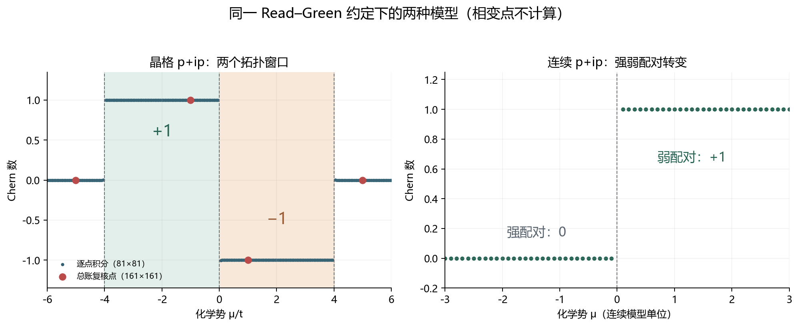

# p+ip 相图与陈数符号：双方法复核及三稿勘误

> 日期：2026-11-10
> 范围：Kitaev／p+ip 数值稿、拓扑超导投稿稿、拓扑物态综述，以及旧 TOE 验证脚本的只读复核。
> 结论级别：模型、符号约定与数值验证；**不是材料实验验证，不覆盖 CdGM、无序、相互作用或实验数字。**

## 一、结论摘要

本次不是用文字投票决定 Ch 的正负，而是先固定 BdG 矩阵、Read–Green 向量和 Berry 联络，再由两条独立路径复核：占据带 Fukui–Hatsugai–Suzuki（FHS）链接变量，以及 E 向量的直接积分。连续模型另用径向紧化积分交叉检查。

在当前约定下：

- **连续模型**：弱配对 $\mu>0$ 时 $C_{\mathrm{BdG}}=+1$；强配对 $\mu<0$ 时为 0；$\mu=0$ 能隙闭合，不计算陈数。
- **晶格模型**：$0<\mu<4t$ 时 Ch＝−1；$-4t<\mu<0$ 时 Ch＝+1；$|\mu|>4t$ 时为 0。三个相变点均不计算陈数。
- 第一稿的“弱配对 Ch＝−1”在该晶格约定下保留，但“$\mu<0$ 全部平庸”错误；第二稿的连续模型可写 +1／0，但其晶格符号、相区和 Kitaev 的 Δ 依赖相界需要纠正；第三稿主要缺少统一向量与可执行证据。
- 旧 TOE 脚本实际输出与自身 docstring 反号，源文件未被本次只读审计修改。



图 1　左：241 个 μ 点的晶格扫描及 161×161 总账复核点；右：连续模型紧化积分。虚线为隙闭合点，不插值、不赋予陈数。

## 二、统一约定：先固定矩阵，再讨论符号

晶格模型固定为

$$
\epsilon_k=-\mu-2t(\cos k_x+\cos k_y),\qquad
\Delta_k=\Delta(\sin k_x+i\sin k_y).
$$

对应的 BdG 矩阵与 Read–Green 向量为

$$
H_{\mathrm{BdG}}=\operatorname{Re}\Delta_k\,\tau_x-\operatorname{Im}\Delta_k\,\tau_y+\epsilon_k\tau_z,
\qquad
E=(\operatorname{Re}\Delta_k,-\operatorname{Im}\Delta_k,\epsilon_k).
$$

Berry 联络采用 $A_\mu=+i\langle u|\partial_{k_\mu}u\rangle$。绕数写为

$$
C_{\mathrm{BdG}}=\frac{1}{4\pi}\int_{\mathrm{BZ}}
\hat E\cdot(\partial_{k_x}\hat E\times\partial_{k_y}\hat E)\,d^2k.
$$

FHS 链接变量满足

$$
U_\mu(k)=\frac{\langle u(k)|u(k+\mu)\rangle}{|\langle u(k)|u(k+\mu)\rangle|},\qquad
C_{\mathrm{BdG}}=-\frac{1}{2\pi}\sum_k\arg[U_x(k)U_y(k+x)U_x(k+y)^{-1}U_y(k)^{-1}].
$$

这里的整体负号来自所选 Berry 联络与链接展开，不能漏掉。E 向量的 $-\operatorname{Im}\Delta_k$ 也不能改成 $+\operatorname{Im}\Delta_k$ 后继续声称在计算同一个矩阵。Read–Green 原文用于固定理论背景，FHS 原文用于固定离散链接方法；最终符号由本稿显式约定和实际计算共同确定。[Read 与 Green 原文](kimi-cite://web?url=https%3A%2F%2Farxiv.org%2Fpdf%2Fcond-mat%2F9906453 "citation")，[FHS 原始论文](kimi-cite://web?url=https%3A%2F%2Farxiv.org%2Fpdf%2Fcond-mat%2F0503172 "citation")

## 三、数值证据与防错检查

### 3.1 晶格双方法

取 $t=1$、$\Delta=0.5$，网格为 41、81、161。直接积分使用 E 的解析导数，FHS 使用最低 BdG 能带的本征矢；两法均先检查 Γ、X、Y、M 的解析隙闭合，再检查采样网格。

| $\mu$ | 相区 | 直接积分 | FHS | 裁决 |
|---:|---|---:|---:|---|
| -5 | $|\mu|>4t$ | 0 | 0 | 平庸 |
| -1 | $-4<\mu<0$ | +1 | +1 | 拓扑 |
| +1 | $0<\mu<4t$ | -1 | -1 | 拓扑，手性相反 |
| +5 | $|\mu|>4t$ | 0 | 0 | 平庸 |

全部 12 个网格结果的最大绝对方法差为 **1.7522414162307598e-05**，远小于 0.03 的预定容差。表中整数来自接近整数的原始浮点值，完整数据未以整数覆盖。[原始结果](kimi-cite://text?path=C%3A%5CUsers%5C%E4%B8%80%E6%A2%A6%5CDocuments%5Ckimi%5Cworkspace%5C.worktrees%5Cprovider-main-integration%5Cpapers%5Ctopo-quantum-internet%5Cverification%5Cpip_chern_convention_results.json&text=maximum_absolute_method_difference "citation")

### 3.2 连续模型

连续模型取 $E=(r\cos\phi,-r\sin\phi,r^2-\mu)$，使用 20,000 个径向区间的复合 Simpson 求积，并补上无穷远北极的解析尾部：

$$
C_{\mathrm{BdG}}=\frac12\int_0^R\frac{r[r f'(r)-f(r)]}{[r^2+f(r)^2]^{3/2}}dr+
\frac12\left(1-\frac{f(R)}{\sqrt{R^2+f(R)^2}}\right),\qquad f(r)=r^2-\mu.
$$

计算给出 $\mu=1$ 时 1.0；$\mu=-1$ 时 $-10^{-9}$ 量级，按 $10^{-6}$ 容差为 0。该尾项来自紧化边界，不是将截断误差四舍五入。

### 3.3 反例与防护

- $\Delta_0\mapsto-\Delta_0$ 只改变配对整体相位，陈数不变；$\Delta_k\mapsto\Delta_k^*$ 才反转手性。
- μ＝−4、0、4 以及连续模型 μ＝0 会触发 `ValueError`，不生成貌似稳定的陈数。
- 41×41 的中心差分曾出现约 5% 偏差，因此改为 E 的解析导数；没有放宽阈值掩盖粗网格误差。
- 连续积分分别修正了极坐标面积元、数值求积和无穷远尾部；原始负零附近浮点值被保留，没有强制写成 0.0。

## 四、逐稿勘误

| 对象 | 原问题 | 本次处置 | 仍未完成 |
|---|---|---|---|
| Kitaev／p+ip 数值稿 | E 向量把 +ImΔ 与矩阵错配；Ch＝−sgn(μ) 不适用于整个晶格；μ＝−2t 被误标为平庸 | 改为 −ImΔ；保留 0<μ<4t 的 −1，补入 −4t<μ<0 的 +1；同步结论与原始数据链接 | 涡旋 CdGM、有限尺寸、无序和相互作用 |
| 拓扑超导投稿稿 | 连续与晶格混写；晶格符号不符；Kitaev 相界被误写为依赖 Δ；“首次”与 200×200 实证声明缺证据 | 连续模型单列 +1／0；晶格使用实际 −1／+1／0；恢复 $|\mu|<2t$；记录真实网格与脚本 | 实验数字、25 nm 对应、涡旋谱和其他过度承诺 |
| 拓扑物态综述 | 有连续模型结论，但没有统一向量、晶格边界和可执行结果 | 补入 Read–Green 向量、连续／晶格区分和证据链接 | 全篇实验与工程化表述仍须独立核查 |
| 旧 TOE 验证脚本 | docstring 与代码向量、实际输出不一致 | 只读执行并保存哈希和输出；不作为新裁决的基准 | 后续应在独立分支修复旧脚本及其测试 |

## 五、旧脚本的只读复核

旧函数实际返回：μ＝+1 时 Ch＝+1，μ＝−1 时 Ch＝−1；其 docstring 却写为 −1 与 +1。代码采用 $d=(\operatorname{Re}\Delta,+\operatorname{Im}\Delta,\epsilon)$，与所要求的 E 向量符号不同。运行前后 SHA-256 均为 `c98debd85ea509fe683d60a8d0d3d380cf92bacbd66ba30c0aae2c3d30f95556`，证明本次未修改旧源文件。[只读复核结果](kimi-cite://text?path=C%3A%5CUsers%5C%E4%B8%80%E6%A2%A6%5CDocuments%5Ckimi%5Cworkspace%5C.worktrees%5Cprovider-main-integration%5Cpapers%5Ctopo-quantum-internet%5Cverification%5Clegacy_pip_chern_audit.json&text=docstring_mismatch_confirmed "citation")

这条记录解释了为什么不同稿件和脚本会各自“验证”不同符号：**验证工具自身的约定与注释也必须接受审计。**

## 六、验证命令与结果

在 `papers/topo-quantum-internet/verification` 目录执行：

```text
python -m unittest discover -s . -p "test_*.py" -v
python pip_chern_convention.py
python audit_legacy_pip.py
python plot_pip_chern_phase.py
```

当前结果：15 项测试全部通过，退出码 0，其中包括 11 项数值与文稿测试、4 项交付物检查；原始结果生成器退出码 0；旧脚本只读审计确认 `docstring_mismatch_confirmed`；相图包含 241 个晶格扫描点和 60 个连续模型点。测试没有覆盖实验数据、材料参数或 CdGM 谱，因此不得据此宣称整篇论文已完成投稿级验证。

## 七、未竟事业与下一步

1. **旧脚本分支修复**：在新分支把 E 向量、docstring、测试和实际输出统一，保留本次只读证据，不在当前证明分支混入无关改动。
2. **涡旋谱真实求解**：公开涡旋 ansatz、径向网格、边界条件与 CdGM 本征值，不能把 m＝0 的手写点当成数值解。
3. **实验数字逐项回源**：99.2%、78%、500 μs、25 nm 与具体测量体系分别核查，不把不同平台拼成单一“高度一致”。
4. **扩展物理模型**：在统一符号后研究无序、相互作用和有限尺寸标度，再讨论其对新物理方向的意义。

本次完成的是相图、符号和证据链的局部清偿。它不证明一个新 TOE，也不把标准模型的复现包装成外部首创。
