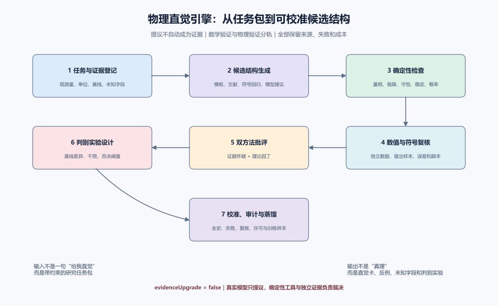

# 数学—物理观与数学层级观：证据、边界和 AI 时代的制度设计

**版本**：1.4（2026-11-07；初稿 2026-10-26）
**性质**：批判性综述、方法论框架与仓库整改依据；不是新的物理统一理论
**配套文档**：`TOE_RESEARCH_ATLAS_2026.md`、`CNF_RESTRUCTURING_2026.md`、`62_mathematical_hierarchy_emergence.md`

> 本文把“内部数学真理”“物理模型的适用性”“研究组织的资源分配”分开。文中使用“已核实”只表示已读取所指来源的相关部分，不表示独立证明了来源中的全部定理，更不表示独立复现了其实验。

## 摘要与十六项结论

1. 知乎文章《唱唱反调……解决了一个寂寞》对王虹—Zahl 定理的转述有误：满 Hausdorff/Minkowski 维数不是正 Lebesgue 测度，也不是覆盖整个空间；单个零测度对象的并集不必仍为零测度。文章没有据此推翻挂谷定理。
2. “数学规则不再全域有效”必须拆成两句：定理可以在公理系统内全域有效；物理映射只在声明的对象、尺度、近似和测量协议内有效。越界失败首先否定映射，不是否定定理。
3. 没有证据表明数学已经不再是描述世界的最简语言。“最简”依赖编码、误差、计算预算、外推目标和可理解性；它是多目标选择，不是绝对本体论标签。
4. 数学中的逻辑强度层级、对象抽象层级、计算复杂度层级、物理有效理论层级、社会生产成本层级都有各自根据，但不存在一个把它们自然熔成唯一阶梯的已知科学定律。
5. “数学层级与证明费用成正比”不成立为普遍命题。更强的形式系统有时能大幅缩短证明；搜索、形式化、命题忠实性审查和独立复核又是不同成本。
6. OpenAI 当前官方目录为 721 篇、373 个成果族，官方报告约 42% 的 top-line results 有 Lean 形式化。数量不是全部正确的证明，更不是完整成本审计。[R7]
7. 高阶级数发散不是数学失效，也不自动带来物理信息。它可以是渐近展开；最佳截断、Borel 求和和 resurgence 在特定条件下有用，但一般需要额外的解析与非微扰信息。
8. AI 若能廉价生成高阶项，人类“优雅”应更多指结构识别、误差控制、可迁移解释和提出好问题；物理直觉应被登记为可校准、可否证的模型选择启发式，而非不可讨论的灵感权威。
9. 本仓库 CNF 指 Causal Network Field（因果网络场），是项目自定义研究框架，不是学界统一定义，也不是合取范式。现有材料不足以把 CNF 认定为完整的统一物理理论，但其因果网络、计算接口和证据治理可以保留。
10. “TOE→综述→CNF”能形成研究地图，也易产生语义吞并、确认偏误和已知理论重述。应改为“定点问题与基线→最弱抽象→判别实验→反向综述”的闭环。
11. 没有一般定理证明某一种 TOE 永远不能吞并其他 TOE，也没有定理保证最终统一。真正可操作的是比较低能极限、可观测量、自由参数、近似域和区分性预言。
12. 跨学科应采用接口联邦而不是概念帝国：统一标识、单位、数据协议、不确定度和证据门槛，不要求所有领域共享一个拉格朗日量或一个“熵”。
13. 观测检验的对象是写清辅助假设、参数和系统误差的联合模型，而不是一个理论标签。CMB 可以否证明确的联合模型及其参数区域，但不能单独排除“暗物质”这个总类，更不能代替粒子探测。
14. 多探针结果不能按实验数量或显著性数字简单累加。ACT、SPT 与 Planck 的联合透镜同原初 CMB 相容，DESI DR2 与 CMB 则存在数据和模型相关的轻中度张力；部分替代引力也能兼容线性 CMB。下一步应比较完整似然和系统误差，而不是投票决定理论真伪。
15. 粒子暗物质、动态暗能量与修改引力不是互斥标签。应分别登记背景丰度、线性扰动、非线性屏蔽、粒子微观性质和测量系统模型；\(w(z)\) 或 \(\Omega_c h^2\) 不能鉴定粒子身份，参数偏离显著性也不能替代模型比较。
16. “无暗物质”必须先审查物质部门。Khronon 的场能密度可以承担暗物质角色；其线性 GDM 对应不等于完整数据拟合，作用函数尚未由基本物理解释，高阶结构需要 N 体模拟，小波数哈密顿量还存在无下界问题。不能把它直接当成无 CDM 或已验证的完整理论。

---

## 1. 挂谷争议：先恢复命题，再讨论价值

### 1.1 原论文实际证明了什么

Wang 与 Zahl 的 127 页论文把三维 Kakeya 集定义为 \(\mathbb R^3\) 中包含每个方向单位线段的紧集。其定理 1.1 是：每个这样的集合都具有 Minkowski 维数 3 和 Hausdorff 维数 3。摘要同时说明主要技术结果是满足非聚集条件的 \(\delta\)-管族之并的近乎最大体积估计。论文还明确说，它**没有**解决三维 Kakeya maximal function conjecture。[R1]

因此，至少下列推论都不在定理之中：

- 集合具有正的三维 Lebesgue 测度；
- 集合覆盖整个 \(\mathbb R^3\) 或某个开球；
- 任意维数的挂谷问题都已解决；
- 该证明已经直接产生通信、雷达或医学成像工程改进；
- 数学规则只在局部成立、在全局失效。

2026 年公开综述仍以“即使普通体积为零，分形维数也必须最大”解释这一区别。[R2] 这意味着“体积为零”与“满维数”可以同时成立，不是逻辑矛盾。

### 1.2 争议原文的三处概念错误

争议原文把一条零体积线段与无数线段的并集相比较，并把满维数称为“充满整个空间”。[R3]

**错误一：把零测度当成可任意求和的实物计数。** Lebesgue 测度具有可数次可加性，不是“任意个零测度集合之并仍为零”的规则。即使全部是不可数个零测度点，区间 \([0,1]\) 的并仍有正测度；Cantor 集则仍是零测度且具有非零 Hausdorff 维数。并集的几何组织方式不可省略。

**错误二：混淆测度、维数和覆盖。** 满 Hausdorff 维数不等于正测度，更不等于覆盖。墙面、面积、体积是不同维数的理想化对象；把“无限多个面”当成日常物体堆叠，必须另外给出极限、测度和物理厚度模型。

**错误三：把物理本体论争议当成数学反证。** 即便有人不认同分形几何在某一物理问题中的适用性，也只能据此要求审查物理映射，不能推翻一个在其定义和公理下成立的定理。

“解决了一个寂寞”若是在质疑短期应用价值，可以成为一个讨论问题；若被当成该定理错误或数学上无意义，则缺乏上述命题依据。科普中把该成果直接说成 5G、6G、量子雷达或武器性能提升，也同样需要独立证据，不能用夸张反驳夸张。

### 1.3 值得保留的哲学问题

原文关于“抽象映射→概念替代→自我增殖→路径锁定”的警告可改写为可审查的问题：

- 数学实体何时只是计算工具，何时获得了独立的实验支持？
- 理论成功是在检验核心结构，还是只检验了共同的有效近似？
- 新假设增加了多少自由参数，带来了多少未参与拟合的新预言？
- 共同体是否允许负结果、替代模型和复现失败进入正式记录？

波函数、额外维、超对称和弦景观的物理地位并不相同，不能一锅判为“玄学”，也不能仅凭数学存在就赋予同等的本体论地位。量子力学中的态、经典电磁波和粒子概念需要按各自理论与测量解释，不能从“使用了波动数学”直接跳到“光就是某种经典波”。

---

## 2. 健全的数学—物理观

### 2.1 真理、模型、数据三分

一个可检验物理模型至少应写成

\[
M=(S,\mathcal D,\mathcal O,I,\mathcal C,\mathcal E),
\]

其中 \(S\) 为状态与自由度，\(\mathcal D\) 为动力学，\(\mathcal O\) 为可观测量，\(I\) 为从形式对象到测量操作的解释映射，\(\mathcal C\) 为适用条件，\(\mathcal E\) 为误差与不确定度模型。

- **数学问题**：在给定规则下，是否有 \(M\vdash\varphi\)，证明是否依赖额外公理？
- **语义问题**：形式对象 \(\varphi\) 是否确实对应目标实验中的量，而非同名不同物？
- **经验问题**：在条件 \(\mathcal C\) 和误差 \(\mathcal E\) 下，数据是否支持该映射？
- **理论选择问题**： competing models 是否在参数、外推、稳健性和解释上存在可比较差异？

“1+1=2”作为整数运算与其在某种非可加物理量上的操作不是同一命题。非欧几何也不是证明欧氏几何内部矛盾，而是改变几何公理及适用对象。数学内部成立与物理实例化不是相互替代，而是相互约束。

### 2.2 数学为何有效：互补而非唯一的说明

Wigner 既指出数学概念在物理中出人意料地有效，也明确怀疑理论的唯一性，并强调物理定律的条件性与有限范围。[R4] 现有经验支持以下互补机制：

1. **不变量和对称性**：可重复实验需要识别哪些条件可忽略；对称性为此提供压缩。
2. **局域性和可分离性**：部分系统可在控制其他条件后单独研究，才有短规则的可迁移性。
3. **尺度分离和普适性**：大量微观细节在某些低能或临界宏观问题中只通过少数相关参数进入。
4. **稳定结构**：拓扑、守恒量、谱结构和渐近形式往往比单个轨迹更稳健。
5. **模型选择与表达共同演化**：物理推动新数学，数学又提供反直觉但可检验的新结构。

这些机制解释了“为什么某些数学在某些领域非常有效”，却不证明“整个宇宙就是某一个数学对象”。数学宇宙假说、结构实在论、工具主义和涌现论仍属于需要分别论证的立场。

### 2.3 数学是否仍是“最简描述世界的语言”

不存在脱离目标与编码的最简描述。最小描述长度（MDL）提供了有用范式：在模型与数据拟合之间权衡编码成本，但它仍依赖模型类和编码方案，不能被升格为“最短者必真”。[R5]

研究上更可操作的是多目标评价：

\[
J(M)=L(D\mid M)+\lambda L(M)+\gamma C_{\rm compute}(M)
+\rho U_{\rm extrapolate}(M)+\eta H_{\rm audit}(M).
\]

这里分别表示数据残差、模型描述、计算成本、外推不确定度和审查/理解成本。权重不是自然常数；不同科学任务可以有不同选择。高阶代理模型可能在固定误差内比“基本方程”便宜，却不因此成为更基本的本体论。反过来，一个简短方程若需要不可承受的全局模拟，也不等于实践中最简。

**结论**：数学仍是物理不可替代的精确表达与推理基础设施，但“唯一最简的世界语言”不是已被证明的科学命题。物理还需要实验设计、校准、误差模型、因果假设和公共复核来闭合。

---

## 3. 数学层级：有根据的是多个类型化层级，不是唯一等级制

### 3.1 六种不能混用的层级

| 层级 | 合理定义和证据 | 可以研究的问题 | 不能直接推出 |
|---|---|---|---|
| 逻辑/元数学 | 公理强度、可证性、保守扩张、证明加速 | 某命题在哪个系统可证、证明多长 | 更高系统一定更真实或更昂贵 |
| 数学对象组织 | 范畴、高阶范畴、谱序列、抽象层级 | 结构如何复用、映射何时存在 | 抽象级数等于物理能量 |
| 计算复杂度 | 输入规模下的时间、空间、电路、查询和证明复杂度 | 某项计算是否可行、资源如何缩放 | 难度总随“抽象高度”增加 |
| 有效物理理论 | 能标、粗粒化、RG、匹配、误差控制 | 低能参数从何而来、何时换模型 | 所有学科有同一全局格 |
| 涌现与解释层级 | 多尺度稳定性、多重实现、自治宏观变量 | 何时宏观解释不可被短期微观计算替代 | 宏观规律与微观规律矛盾 |
| 社会生产成本 | 搜索、算力、形式化、审查、理解、协作费用 | 怎样分配研究资源、如何减少复核积压 | 成本是宇宙的基本物理量 |

所谓“数学层级宣言”若只表示分类管理，可以作为工程约定；若声称自然界必然服从一个有限格、每层都是下一层的 Galois 闭包，则需要独立推导和证据，不能以宣言代替。

### 3.2 可用的最低形式化

令 \(\Sigma\) 是带偏序的尺度或任务标签集合，不要求全序、最大元或最小元。每个 \(s\in\Sigma\) 配有模型 \(M_s\) 和观测量集合 \(\mathcal O_s\)。某些有序对 \((s,t)\) 可以存在粗粒化映射

\[
R_{s\to t}:S_s\to S_t.
\]

只有当映射类型匹配、恒等映射和复合结合律明确成立时，才可把这一结构称为范畴。近似复合必须写成

\[
R_{t\to u}\circ R_{s\to t}\simeq_\varepsilon R_{s\to u},
\]

并说明 \(\varepsilon\) 的度量、条件和方向。范畴命名本身不产生物理内容；涌现、重整化和基本性都要另外检验。[R6]

### 3.3 对旧 TOE-62 的关键审计

旧文件 `62_mathematical_hierarchy_emergence.md` 已有重写版。为避免旧“定理”继续被引用为事实，保留以下裁决：

| 旧主张 | 本轮裁决 | 原因或最低补救 |
|---|---|---|
| 所有层级构成有限格且有最基础/最涌现端点 | 未证假设 | 多尺度结构可以只是偏序、网络或不同坐标系 |
| \(E\Delta x\sim\hbar c\) 对指定层“精确成立” | 撤回 | 不确定性关系通常是带因子和态依赖的数量级关系，不给全局精确标度函数 |
| 每层是下一层的 Galois 闭包 | 删除 | 类比一般关系不能替代域扩张、群作用和不动域的证明 |
| 涌现必然降低 Kolmogorov 复杂度且产生分数响应 | 删除普遍性 | 应改成给定编码下的条件压缩和逐模型稳定性 |
| 临界指数只由两层维度与对称性决定 | 撤回 | 还涉及相互作用范围、动力学、上临界维数和普适类 |
| RG 可无条件视为任意层级范畴的自函子并给出层跃迁速率 | 未证 | 需明确理论空间、截断、半群/群性质及观测对应 |
| 临界面在层间映射后必有非平凡拓扑保护 | 反例否定普遍性 | 单点临界集合的连续像仍可无高阶非平凡同伦群 |
| 任意 Fisher 度量满足跨层三角不等式且等号为无损 | 撤回 | 正确命题需同一参数、参数无关 Markov kernel 和相应矩阵偏序 |
| 任意层间存在伴随函子 | 反例否定 | 常值粗粒化可以丢失信息，不必存在右伴随或逆映射 |
| 层化层的整体截面存在等价于 TOE 一致 | 撤回 | 局部截面无法粘合与全局物理矛盾不是同一概念 |
| 粗粒化与精细化构成准逆 | 与信息损失冲突 | 非可逆粗粒化通常没有逆映射 |
| 基本常数必须在所有层间映射下不变 | 撤回 | QED 耦合会随能标跑动；需指定量、能标与重整化方案 |
| 精细结构常数必有最大层级权重 | 无定义域内计算 | 原“权重”是自定义量，未提供全层配分函数和可复核求和 |

这里的“反例”只反驳全称命题，不否认在特殊模型中可建立 Galois 对应、伴随、不动点或拓扑保护。修正后的方向是**条件化的小定理**，不是以更宏大的口号替换旧口号。

---

## 4. OpenAI、数学层级和证明费用

### 4.1 已核实的发布边界

截至本轮读取，`openai/math` README 的当前目录为 **719 manuscripts / 372 families**；官方将约 **42%** 表述为 top-line results 的形式化比例。README 还说模型曾被提出约 4,000 个问题，平均每项结果使用约三小时 ChatGPT Pro thinking compute，模型未公开。不同成果的验证阶段不同，未形式化结果可能存在问题。[R7]

`history.md` 记录：2026-10-07 一处符号错误使一篇论文的关键论证失效，并影响两篇依赖论文，故撤回 3 篇；另修订 14 篇。形式化数量是发布方的目录口径，不是对全部命题、语义忠实性和独立复核的认证。[R8]

官方网页的“平均三小时”是算力类比，不是实际 wall-clock、GPU 账单、美元成本或端到端研究成本。[R9] 因成果族、论文和所提问题是不同计数单位，也不能把 372/4,000 当作成功率。

### 4.2 为什么“层级越高，费用越高”不是定律

- 同一命题 \(0=0\) 在强弱不同的许多系统中都可用极短证明完成，逻辑强度并不单独决定成本。
- Gödel speed-up 现象表明，在适当设置中，更强系统可以使某些已有命题的证明显著缩短。[R10]
- 搜索最短证明、把自然语言形式化、检查形式命题是否忠实于原命题、核查外部引理和独立复现，是不同工作。Lean 编译通过不自动完成后四项。
- 物理“层级”还混入了实验费用。更深理论若增加自由度，可能增加拟合与实验成本；若提供更强不变量，也可能降低计算成本。

应使用的成本模型是

\[
C_{\rm total}=C_{\rm search}+C_{\rm formalize}
+C_{\rm statement\ audit}+C_{\rm verify}+C_{\rm review}
+C_{\rm data/experiment},
\]

并记录输入规模、表达系统、硬件、人工时间、失败尝试和选择效应。OpenAI 的发布推动了这种透明化，但其单一平均数不足以估计上述总成本，更不能验证一条普适“层级—费用定律”。

### 4.3 可检验的研究方案

按问题族和既有难度分层，而非按作者宣称的抽象级别分层；公开全部尝试、模型版本、检索预算、token/能耗、人工介入和失败样本。以人类团队和其他自动系统为对照，分别报告首次答案成本、可复核证明成本、语义审查成本及最终正确率。只有这种面板数据才能研究资源与难度的统计关系。

《莱顿宣言》同样把证明、理解、清晰、归属、独立验证和学科自主性区分开，恰好说明“产出答案”不能替代整个数学生产过程。[R11]

---

## 5. 高阶项发散之后：优雅与直觉如何重定义

### 5.1 发散不等于无意义，也不等于已解决

若 \(f(z)\sim\sum a_nz^n\) 是 Poincaré 意义下的渐近级数，则它要求固定 \(N\) 后余项在 \(z\to0\) 时受控，不要求固定 \(z\) 后随 \(N\to\infty\) 收敛。许多物理展开具有这种性质。最佳截断、Borel 变换、解析延拓、transseries 和 instanton 等非微扰扇区，可在特定模型中恢复额外信息。[R12]

但必须同时坚持：

- 不是每个高阶展开都能唯一求和；
- 正实轴上的 Borel 奇点、非微扰 ambiguity 和边界条件可能不可忽略；
- 自动生成更多系数并不证明展开参数正确，也不证明物理模型正确；
- 数值吻合若不包含独立基准和误差分析，仍可能只是拟合或重复已有公式。

因此，“高阶项发散成为常态”目前只能作为**条件性未来情景**，不能作为已被观测证明的全球科研状态。

### 5.2 数学家的优雅

从“短公式、巧构造”扩展为以下可学习的能力：

1. 找出不变量、对称性、正规形和可复用结构；
2. 把庞大计算分解为可审查的引理与语义接口；
3. 知道在哪个尺度、误差和近似下一种描述优于另一种；
4. 把机器输出压缩成可解释的少数机制，同时保留反例和适用边界；
5. 提出能改变研究拓扑的问题，而不仅是在既定榜单上增加解数。

形式化并没有消灭理解，反而把“命题是否被正确翻译”提升为核心工作。短证明不一定比可迁移的长证明更有价值，计算证书也不自动等于物理洞见。

### 5.3 物理学家的直觉

可把直觉定义为**由经验形成的、用于提出和筛选模型的可校准先验**，而不是免检验的真理感。典型启发式包括量纲分析、对称性、极限情形、局域性、尺度分离、稳定性、能量与熵约束、守恒律和奇点诊断。它们的可靠性取决于问题分布，必须通过事后校准学习。

建议每条直觉登记为一张“启发式卡”：

| 字段 | 内容 |
|---|---|
| 触发线索 | 哪些观测使人联想到该机制 |
| 候选模型 | 明确自由度和方程，而非只写意象 |
| 适用域 | 尺度、边界、近似和测量协议 |
| 快速检验 | 量纲、极限、守恒、对称、数量级和已知反例 |
| 判别预测 | 与最简基线或其他直觉不同的观测 |
| 失败记录 | 何时失效、如何修正、是否曾被误用 |
| 校准统计 | 前瞻命中率、过自信程度、返工成本 |

### 5.4 把直觉制度化的九步流程

1. **前瞻登记**：先看数据前写下机制和排除条件。
2. **多模型竞赛**：至少保留一个常规物理基线和一个无新机制空模型。
3. **极限与反例审查**：在拟合前先检查已知极限、量纲和守恒律。
4. **盲数据与负对照**：使用未参与构造的样本、伪数据和错误机制对照。
5. **机器基线**：比较暴力拟合、高阶展开和符号回归，避免把算力当成洞见。
6. **独立复核**：由未参与构造者检查命题、代码、数据和参数冻结。
7. **失败复盘**：把失败直觉同样入库，避免只保存成功故事。
8. **前瞻校准**：按固定任务分布统计命中与过自信，不按记忆挑选案例。
9. **教学转化**：用正例、近 miss 反例和边界问题训练新人，使“经验”可以传递。

这就是把物理直觉从私人灵光转成公共、可比较、可纠错的研究技术；并不是把直觉机械化为一套永远正确的算法。

---

## 6. 对 CNF 与 TOE 研究的世界观约束

CNF 的研究对象应是从局部因果结构到宏观可观测量的映射，而不是“所有名词都有网络解释”。其最低规范是：

- 图/事件集、状态空间、局部更新规则、观测量和初始/边界条件明确；
- 说明何时存在连续极限、 Lorentz 对称性、规范冗余、量子演化和低能场论；
- 对标准模型与广义相对论分别给出恢复条件，而非只复用名称；
- 把兼容性检查、后验拟合、独立新预言和独立实验复现分开；
- 对化学、材料、地质和生物数据额外保存原始读数、样品/仪器元数据、预处理、排除规则和独立数据源。化学数据确有错误和造假风险，但不能在无统计依据时给整个学科定罪；通用的高风险证据审计比笼统怀疑更可靠。

具体整改见 `CNF_RESTRUCTURING_2026.md`，系统课题见 `TOE_RESEARCH_ATLAS_2026.md`。

## 7. 最终数学物理观

本文采用以下十条工作原则：

1. 数学真理由定义、假设和推理支撑，物理由数学、测量和公共证据共同支撑。
2. 一个模型越界不等于数学规则失效；一个定理抽象也不等于物理无关。
3. 不存在已知唯一的“数学高度”；不同层级必须通过明确映射和误差连接。
4. 有效理论不是“错误理论”，而是在声明范围内具有可控近似的理论。
5. 还原与涌现并不互斥：底层相容和宏观自治可以同时成立。
6. 最简性是任务相关的多目标选择，不是自然的终极裁判。
7. 形式证明、计算可复现、经验检验和独立复核不能互相替代。
8. 美感与直觉应当指导提出假设，不应豁免假设接受反例。
9. 理论之间的矛盾是定位适用域和设计判别实验的资源，不是必须掩盖的缺陷。
10. 统一应当是可选的推论，不是先验强制；保留开放问题比伪造闭合更接近科学。

---

## 8. AI 时代的数学发展：从计算优雅到结构、验证与问题生成

**续写版本**：1.1（2026-11-06）。本节把“高阶项相消是否使数学优雅退化为生理缺陷”拆成计算成本、数学理解和研究组织三个问题。结论不是人类数学家失去价值，而是数学工作的稀缺资源发生迁移：机械展开和常规搜索变便宜以后，命题选择、结构识别、语义映射、错误控制、证明依赖审查和公共复核变得更昂贵，也更不能省略。

### 8.1 “优雅”不是单一的短公式审美

把优雅等同于短公式，是只承认工作记忆成本的审美。它确实曾经帮助人类在有限注意力下形成稳定理论，但数学优雅至少还有另外三种形态。第一是**结构优雅**：一个表示能够暴露对称性、不变量、谱、对偶、正规形或普适类，使新问题的机制自动显现。第二是**误差优雅**：一个推导不仅得到结果，还知道余项、适用范围和失效方向，让人明白何时不能继续使用。第三是**公共优雅**：证明可以拆解成可检查的命题、依赖和证书，让不同背景的人与机器都能复核。高阶项的精确相消如果只给出一行结果，可能在这三个维度上仍然是贫乏的；如果它揭示隐藏对称性、生成函数或可求和结构，则本身就是值得研究的数学内容。

AI 迫使数学家重新分配“短”的价值。最短的未审查输出不一定比可分解的长证明更优雅，最小的形式化文本也不一定比忠实于研究问题的自然语言说明更有理解。数学家需要把机器生成的庞大表达式转化为少量稳定的机制，同时保留原计算、反例和失败记录。这里的“简化”不是删除复杂性，而是**在不丢失证据的前提下组织复杂性**。形式化并没有替代理解，反而使“命题是否被正确翻译”“证明是否依赖额外假设”“同名对象是否被混用”成为核心研究活动。

因此，把人类认知限制直接称为“生理缺陷”并不准确。它是不同计算生态中的约束条件，而不是认识论上的低等标志。人类可以提出什么值得证明、哪个反例会改变理论空间、哪个物理映射与自然现象有关；AI 可以协助扩大候选空间并执行局部计算。二者之间不是“直觉对机器”的二选一，而是**候选生成、约束筛选、验证、解释和再提问的闭环**。

### 8.2 六个值得长期投入的数学研究重心

| 研究重心 | 可研究的问题 | AI 可以承担的工作 | 仍然不能自动替代的判断 |
|---|---|---|---|
| 结构与不变量 | 新表示、对称性、对偶、谱、正规形、普适类 | 搜索候选结构、批量检验恒等式、发现异常 | 哪个结构具有研究价值与可迁移解释 |
| 语义与物理映射 | 数学对象如何对应观测量、尺度、近似和实验协议 | 建立候选映射、检查单位和极限、检索相似模型 | 映射是否适用于目标现象，是否只是同名类比 |
| 证明与依赖 | 证明证书、引理依赖、反例、语义忠实性 | 自动形式化、内核检查、依赖追踪、回归测试 | 命题是否正确表达研究对象，额外公理是否合理 |
| 多尺度与误差 | 渐近级数、最佳截断、有效理论、外推不确定度 | 计算高阶项、比较截断、扫描参数区域 | 展开变量是否适当，求和和物理外推是否有依据 |
| 问题与理论生成 | 新构造、新反例、新判别命题、新数学对象 | 大规模候选生成、异常聚类、反例搜索 | 新问题是否深刻、是否只是已有理论重述或人造拟合 |
| 验证与科研治理 | 成本、版本、血缘、失败、复核和校准 | 记录模型与数据、自动审计、独立重放、盲评估 | 结果是否获得独立承认，评价是否覆盖真实研究过程 |

这六个方向共享一个变化：数学研究不再只以“得到答案”作为终点，而以**建立可继续研究的对象与证据链**作为终点。一个候选公式若不能进入证明、计算、反例、数据或实验流程，就仍然只是未经兑现的文本。反过来，一个形式化结果如果只会被内核接受，却没有说明它解决了什么问题，也仍需要语义和应用审查。数学家的工作由单纯的证明者扩展为结构设计者、语义审计者、问题提出者和研究生态维护者。

这也不意味着传统的巧构造、几何直观和短证明失去意义。它们仍然可以提供跳跃式理解和统一解释，只是不能再凭“美”获得免验证特权。AlphaProof 展示了语言模型、搜索和 Lean 验证可以形成闭环，但官方也明确说明部分题目由专家先翻译成形式语言，且不同问题耗时不同；这不是“机器不需要概念”，而是**机器利用人类定义的形式概念与验证环境完成搜索**。[Google DeepMind](kimi-cite://web?url=https%3A%2F%2Fdeepmind.google%2Fblog%2Fai-solves-imo-problems-at-silver-medal-level%2F "citation")

### 8.3 OpenAI 目录给出的真实警示：数量、验证和依赖传播

截至本次续写读取官方 README，`openai/math` 当前目录为 **721 篇、373 个成果族**，官方仍标约 **42% top-line results formalized**。目录没有提供“多数结果依赖高阶项相消”的分类统计，因此不能把网络图片中的概括写成官方事实。官方历史还记录了一次符号错误如何使 stabilization-trace cancellation 失效，并沿依赖关系影响三篇稿件；这比“AI 会不会硬算”更说明未来数学治理的关键：**一个局部错误如何进入结果族、后续引理和公共引用。**[OpenAI Math](kimi-cite://web?url=https%3A%2F%2Fgithub.com%2Fopenai%2Fmath "citation"), [历史记录](kimi-cite://web?url=https%3A%2F%2Fraw.githubusercontent.com%2Fopenai%2Fmath%2Fmain%2Fhistory.md "citation")

数量扩张带来三种不同后果。其一，计算结果数量增加不等于独立问题数量增加，成果族与论文是不同计数单位。其二，Lean 形式化只覆盖部分结果，其余自然语言论证仍需要语义和数学审查，不能把目录状态解释为同行承认。其三，形式化也需要检查命题忠实性和依赖，内核通过并不保证研究者在讨论同一件事。未来的数学制度必须把论文、主张、证明、依赖、模型版本、失败尝试和撤回记录连接成可追踪图，而不是只统计发布数量。

这对“数学是否仍是最简世界语言”的回应也更具体：最简不再是纸面公式最短，而是**在目标精度下，总成本最低的可靠研究路径**。总成本包括生成、形式化、语义翻译、验证、独立复核、错误传播修正以及读者理解。一个短而脆的结果可能把大量成本转移给后续使用者，一个长而可分解的构造可能降低整体审计成本。数学仍然不可替代，但它的效率必须由完整证据链而非公式长度评价。

---

## 9. 可预见的数学工具：先登记候选结构，再兑现其未来用途

### 9.1 从海森堡案例学到的是结构提示，不是术语占卜

海森堡最初处理的是跃迁振幅数组和非对易乘法，Born 随后识别出这些数组可以用矩阵语言表达，并与 Jordan 进一步系统化。真正具有预见性的提示不是“1925 年提前说出矩阵”这一名字，而是更早识别出：**观测量应按两个定态索引、乘法次序不可交换、跃迁与谱是核心对象、对易关系可能替代经典轨道描述。**[历史研究](kimi-cite://web?url=https%3A%2F%2Farxiv.org%2Fhtml%2F2609.29248v3 "citation"), [矩阵力学史](kimi-cite://web?url=https%3A%2F%2Fwww.sciencedirect.com%2Fscience%2Farticle%2Fpii%2FS1355219816301770 "citation")

因此，本项目的“数学工具预见性”定义为：在理论名称和解释定型之前，根据观测、约束和已知结构生成一组候选数学对象，并对它们的潜在用途、映射依据、反例和验证成本进行排序。预见性不是宣称知道未来必然使用什么，而是**缩短从异常结构到候选形式的距离，同时让候选形式尽早接受判别检验**。如果一个候选结构只能提供事后类比，不能导出新的可检验关系，它的“预见分”就必须降低，而不能因叙事动听而提高。

这对其他数学结构也适用。因果集把偏序和离散性放到前台，但流形近似、 Lorentz 结构与现象学仍需分别论证；圈量子引力提供正则量子化与自旋网络路径，非交换几何提供谱三元组和谱作用路径，渐近安全提供泛函重整化群路径，因果动力三角化提供带因果约束的单纯复形与连续极限路径。它们不是可以任意互换名称的“同一种直觉”，而是不同候选结构及其验证计划。[因果集综述](kimi-cite://web?url=https%3A%2F%2Flink.springer.com%2Farticle%2F10.1007%2Fs41114-019-0023-1 "citation"), [渐近安全批判性综述](kimi-cite://web?url=https%3A%2F%2Farxiv.org%2Fabs%2F2004.06810 "citation"), [CDT 综述](kimi-cite://web?url=https%3A%2F%2Farxiv.org%2Fabs%2F1905.08669 "citation"), [非交换几何综述](kimi-cite://web?url=https%3A%2F%2Farxiv.org%2Fpdf%2F1906.09583.pdf "citation")

### 9.2 数学结构卡：每种工具都要标注用途、证据和否决方式

| 字段 | 必须登记的内容 | 禁止的写法 |
|---|---|---|
| 结构签名 | 对象类型、自由度、组成规则、关键不变量、基本方程或关系 | 只写“高级”“抽象”“有潜力” |
| 触发线索 | 哪些观测、异常、约束或已有推导提示该结构 | 只凭同名、相似图形或作者权威 |
| 候选物理用途 | 可能描述的状态、观测量、动力学、尺度与实验协议 | 把“可能”写成“必然揭示宇宙本质” |
| 历史用途 | 已在哪些理论和模型中被使用、限制和修正 | 把历史成功直接外推到目标问题 |
| 判别检验 | 量纲、极限、守恒、对称、稳定、数据、反例和独立实验 | 只寻找支持材料，不登记否决路径 |
| 未知字段 | 尚缺的定义、参数、测量、误差、证明和来源 | 用其他文献或常见条件静默补齐 |
| 证据状态 | 提议、约束通过、计算复核、形式证明、独立数学复核、经验检验 | 把模型提议、形式证明和物理证实混成“已验证” |
| 使用成本 | 生成、计算、形式化、数据、实验和复核成本 | 只用 token 或调用费证明理论优劣 |
| 失败与校准 | 失败记录、近 miss、适用域变化、过自信和返工成本 | 只保存成功故事，删除错误直觉 |

这张卡把数学工具从静态词典变成可更新的研究资产。例如“矩阵”不应只登记为线性代数对象，还应分别记录：有限维状态空间中的线性映射、跃迁振幅数组、算符表示、测量协议、可对易与不可对易结构、谱分解、张量网络和量子信息用途。每次新增用途都要附上映射依据和否决方式；如果某种“物理直觉”只能让人联想到矩阵，却不能提供任何新的关系或检验，它最多是一条待审联想，不是理论进展。

用途标签必须至少分为四类：**已验证的历史用途、待验证的候选用途、仅供类比的联想用途、已经否决的映射。** 这四级不是逻辑证明等级，而是防止研究叙事提前定型的治理标签。一个结构可以在历史问题中成熟，在目标问题中仍然只是候选；同一候选在不同尺度或不同观测量下也可能分别处于不同状态。数学工具预见性因此是持续校准，而不是一次标对未来课程表。

### 9.3 数学结构的类型与接口

| 类型 | 典型对象 | 可用于提出哪些物理候选 | 首批快速检查 |
|---|---|---|---|
| 代数与表示 | 矩阵、李代数、算符、张量、群表示、非交换代数 | 状态与跃迁、对称性、守恒量、谱结构、量子演化 | 对易关系、维数、表示一致性、谱与不变量 |
| 几何与拓扑 | 流形、纤维丛、单纯复形、节点与连接、缺陷、同伦与同调 | 时空、场位形、约束、拓扑保护、连续与离散极限 | 坐标独立性、连续性、边界、拓扑不变量、极限存在性 |
| 分析与动力学 | 常微分与偏微分方程、变分、谱方法、稳定性、渐近展开 | 演化、振动、输运、场方程、稳定性、奇点 | 量纲、守恒、线性稳定性、极限、余项和奇点 |
| 概率与信息 | 随机变量、随机过程、信息熵、 Fisher 信息、推断与校准 | 噪声、测量、统计推断、不确定度、复杂系统 | 归一化、条件独立、数据处理、校准、样本偏差 |
| 逻辑与计算 | 形式系统、证明、类型、算法、复杂度、自动机 | 可计算模型、验证、离散动力学、推理与证书 | 可判定性、复杂度、证明依赖、命题忠实性 |
| 范畴与关系 | 对象、态射、自然变换、极限、函子、伴随 | 跨尺度映射、结构复用、局域到整体、模型关系 | 类型、复合、恒等、结合律、近似复合误差 |
| 数据驱动结构 | 稀疏回归、符号表达式、图模型、因果图、特征库 | 唯象规律、闭合关系、候选动力学、因果假设 | 量纲、过拟合、候选基、干预、外推与可识别性 |

这里不能把“AI 架构”误当成“数学工具分类”。Transformer、混合专家、图神经网络、神经符号系统、符号回归和证明器是实现技术；矩阵、偏序、谱、群、几何、概率与范畴是数学结构。前者提供生成和验证能力，后者提供可检验的表达对象。引擎必须把两类接口分开注册，避免用一个语言模型的回答替代数学对象本身。

---

## 10. 物理直觉引擎：可验证的混合式生产系统



### 10.1 输入、输出与核心不变量

引擎接收一个**研究任务包**，而不是一句“请给我物理直觉”。任务包至少包括：目标现象、数据或其来源、观测量和单位、已知约束、适用尺度、基线模型、必须恢复的极限、允许的计算预算、可使用的证据，以及尚缺的信息。没有数据时允许进入结构探索，但输出只能标为“候选直觉”或“研究假设”，不能伪装成数据驱动发现。缺少目标观测量时先返回澄清任务，不直接生成宏大理论。

输出以“直觉卡集合”为主，每个候选必须包含：候选数学结构、模型陈述、触发线索、可能用途、基线差异、检查结果、未知字段、反例、下一项判别实验、来源与校准状态。引擎的核心不变量是：**提议不自动成为证据，验证不自动成为物理证实，历史成功不自动成为当前适用，模型评分不自动成为真理排序。** 所有候选默认 `evidenceUpgrade=false`，只有通过显式、可复核的检查才改变各自检查状态。

直觉引擎也不把“最好”定义为语言最漂亮或辩论最强势。可比较的指标包括：前瞻判别命中率、错误自信程度、已知极限恢复率、反例检出率、独立复现率、候选多样性、返工成本、数据与实验成本，以及来源可追溯比例。任何单项高分都不能掩盖其余失败。特别是“回答像某位评论者”不作为物理质量指标。

### 10.2 七阶段工作流

| 阶段 | 输入与处理 | 主要产物 | 不得越过的边界 |
|---|---|---|---|
| 1. 任务与证据登记 | 分离原始数据、重建量、诠释、约束、基线和未知字段 | 任务包、证据账本、否决条件 | 不把重建数据当原始测量，不把缺失条件补成事实 |
| 2. 候选结构生成 | 数学模板、历史谱系、符号回归、文献检索、模型提议 | 多样化候选结构及触发线索 | 不把模型生成称为独立发现，不静默删除常规基线 |
| 3. 快速确定性检查 | 单位、极限、守恒、对称、稳定、因果、维数、归一化 | 检查报告、硬反例、未知字段 | 不用语言评分覆盖硬约束失败 |
| 4. 数值与符号复核 | 独立数据、留出样本、符号推导、灵敏度和误差分析 | 数值证书、拟合与外推差异、可重放脚本 | 不用同一数据构造并验证，不把拟合称为定律 |
| 5. 方法批评与理论演化 | 证据怀疑、理论谱系、反例、负结果和替代模型 | 批评意见、修正候选、适用域变化 | 不把评委口吻当证据，不通过多数投票决定真理 |
| 6. 判别实验设计 | 比较候选与基线的不同观测量、成本与可行性 | 前瞻登记、实验或观测建议、否决阈值 | 不把不可执行修辞当成证伪条款 |
| 7. 校准、审计与蒸馏 | 保存全史、独立复核、失败复盘、更新方法卡 | 校准报告、审计束、可训练数据 | 不用未经核验的生成文本训练学生并宣称升级 |

符号回归可作为其中一种候选生成器，而不是整台机器。AI Feynman 把物理先验引入符号回归，说明量纲和物理结构可以指导搜索；SINDy 则表明测量变量、数据质量和候选基函数会限制动力学识别。它们适合产生可检查的表达式和稀疏模型，却不能独自决定哪个表达式是物理定律。[AI Feynman](kimi-cite://web?url=https%3A%2F%2Fwww.science.org%2Fdoi%2Fabs%2F10.1126%2Fsciadv.aay2631 "citation"), [SINDy 原始论文](kimi-cite://web?url=https%3A%2F%2Fwww.pnas.org%2Fdoi%2Fabs%2F10.1073%2Fpnas.1517384113 "citation")

因果发现也必须保持克制。仅由观测分布得到的图往往只能识别到马尔可夫等价类，干预和实验设计才帮助缩小候选集合。引擎必须把“相关结构”“因果候选”“干预后仍成立的候选”分别标注，不能因模型输出了箭头就宣称识别了机制。[因果实验选择](kimi-cite://web?url=https%3A%2F%2Fwww.jmlr.org%2Fpapers%2Fvolume14%2Fhyttinen13a%2Fhyttinen13a.pdf "citation")

### 10.3 双方法评委：证据怀疑与理论园丁

第一类评委命名为 `evidence_skeptic`，只提炼 wa9527we 相关公开讨论中可复用的方法：结论是否偷含前提、局部反例能否被错误推广为全域否定、候选理论族和具体成分是否被混用、证伪条款是否能实际执行、原始测量与重建诠释是否分开、辅助假设是否免除了自身检验。它的价值不是“毒舌”，而是**迫使每个直觉卡交出可执行的反驳路径**。公开回复中把“新闻变常态”改写为可登记、可统计、可核查的协议，正体现了这种方法价值。[公开讨论](kimi-cite://web?url=https%3A%2F%2Fzhuanlan.zhihu.com%2Fp%2F2079855144901011157 "citation")

第二类评委命名为 `theory_gardener`，只提炼沧海红尘公开文章及双方回复中可见的理论演化方式：从不同领域借入结构、追踪其数学事实、把宏大叙事拆成可检查的小命题、接受主流谱系与负结果、保留修改和承认不确定性的记录。它的作用不是为所有灵感背书，而是**把灵感变成可比较、可修订、可判别的候选模型**。例如离散网络、几何阻挫和隐性信息等提议必须分别标注数学事实、类比、定义缺口和待检验内容，不能以“隐性”一词代替映射本身。[原文](kimi-cite://web?url=https%3A%2F%2Fzhuanlan.zhihu.com%2Fp%2F2091384018986182648 "citation"), [双方回复](kimi-cite://web?url=https%3A%2F%2Fzhuanlan.zhihu.com%2Fp%2F2098087169327888097 "citation")

两位真实用户都不会被复制为人格、语气或立场。公开主页全文目前没有被完整抓取，引擎使用的是本次检索获得的公开原文和双方回复信，并保留来源范围说明。后续若增加公开材料，应先登记来源、日期、许可和摘录，再抽取方法卡，而不是把全文直接倒入“人格蒸馏”任务。任何模型生成的评委意见都只是待复核建议，不代表相关用户本人，也不代表其当前或未来立场。

---

## 11. AI 的发展、架构与种类：按功能组合，而不是按品牌排队

### 11.1 七类实现架构及其适当位置

| 实现架构 | 适合承担的功能 | 不应被误认为 | 接入时的验证要求 |
|---|---|---|---|
| 稠密 Transformer 语言模型 | 候选结构提议、文本解释、文献联系、反例草案 | 经过证明的数学对象或独立物理证据 | 命题与来源审查、硬约束检查、独立验证 |
| 混合专家与多 Provider 路由 | 按任务分配不同模型、控制成本、互补失败模式 | 自动形成正确共识或真理多数票 | 路由记录、实际模型、失败和用量透明化 |
| 图神经网络与关系模型 | 节点连接、网络动力学、谱结构、关系预测 | 自动获得物理因果或连续极限 | 图的物理含义、边界、谱与连续映射 |
| 符号回归与稀疏系统识别 | 从数据生成可读表达式、闭合关系、候选动力学 | 从有限数据唯一恢复自然定律 | 留出数据、噪声、候选基、外推和量纲检查 |
| 因果发现与实验设计 | 生成因果候选、选择干预、比较可识别性 | 仅由相关分布唯一确定机制 | 等价类、干预、负对照、混杂与可识别性审查 |
| 神经符号与形式证明 | 引理生成、证明搜索、形式验证、依赖检查 | 自动保证命题忠实于研究对象和物理映射 | 内核检查、语义审查、公理与依赖审计 |
| 混合式科学智能体 | 串联生成、检查、批评、实验、校准与审计 | 自主完成无条件科学发现 | 全链路来源、失败、成本、盲评估和人工复核 |

近年的符号回归综述已经把确定性搜索、进化方法、序列到序列模型、强化学习、物理约束和混合方法并列，而不是把它们归结为“大模型替代数学”。这意味着实现“物理直觉”需要的是任务路由：用生成模型提供多样性，用符号和数值工具检查表达式，用形式系统检查证明，用因果与实验设计区分相关和机制，用审计系统保留全部失败。[符号回归综述](kimi-cite://web?url=https%3A%2F%2Flink.springer.com%2Farticle%2F10.1007%2Fs11831-026-10681-w "citation")

混合专家与多 Provider 也必须谨慎使用。不同模型可能共享训练偏差、错误引用和相似幻觉，不能把相互复述当成独立验证。真正有用的是能力互补：一个模型擅长提出候选，另一个擅长来源检查，确定性工具负责硬约束，独立数据或内核负责最终裁决。模型角色和实际返回必须完整记录，不能把“蜂群一致通过”写成科学证据。

### 11.2 开放模型与数据底座：可用，但不能免审计

开放权重模型为本地学生模型、私有任务数据和可重复实验提供了基础。Qwen 官方仓库列出多种尺寸并声明开放权重模型采用 Apache 2.0，适合按本地算力选择候选学生；DeepSeek 的蒸馏系列则展示了将推理行为从大模型迁移到较小模型的工程路径。选择时不以品牌或单次榜单为唯一依据，而要比较数学与科学任务、上下文、部署成本、许可、工具接口和失败分布。[Qwen](kimi-cite://web?url=https%3A%2F%2Fgithub.com%2FQwenLM%2FQwen3 "citation")

OpenMathReasoning 的数据管线把数学问题、长推理、工具集成推理和候选选择分开，说明学生训练不仅可以模仿最终答案，还可以学习调用工具和比较候选。NVIDIA 的公开文档同时提供数据构造方式，为复现实验、筛选样本和追踪来源提供接口。借鉴的重点是**训练任务分解和生成选择**，不是无审查复制全部语料。[OpenMathReasoning](kimi-cite://web?url=https%3A%2F%2Fgithub.com%2FNVIDIA-NeMo%2FSkills%2Fblob%2Fmain%2Fdocs%2Freleases%2Fopenmathreasoning%2Fdataset.md "citation")

“可以抄袭现有模型”在本项目中被规范为：可以复用开放架构、公开权重、公开数据、公开算法和验证流程，但必须逐项保留许可、作者、版本、来源、修改和适用范围。开放权重不等于训练数据开放，公开可下载不等于可以省略引用，公开文章也不等于可以抹去原作者。对学生模型的每次训练都应输出数据清单、许可清单、教师模型、筛选规则、剔除样本、评估结果和可复现配置。

### 11.3 从公开材料到方法蒸馏的五段管线

| 阶段 | 实际工作 | 质量控制 | 不能得到什么结论 |
|---|---|---|---|
| 来源登记 | 保存公开链接、作者、日期、摘录、回复关系、许可和覆盖范围 | 不声称覆盖完整主页，不把回信误当对方原文 | 不能据此确定真实用户全部观点或人格 |
| 方法抽取 | 把材料转成批评规则、结构生成规则、负结果、修订历史和案例 | 同时保留反例、适用范围、原句定位与不确定性 | 不把语气、修辞或立场当成普适方法 |
| 教师生成 | 用方法卡生成候选、反例、判别实验、失败原因和替代解释 | 真实模型、版本、结束状态、用量和原文全部留痕 | 不把教师输出自动当成正确标签 |
| 确定性筛选 | 去重、硬约束、来源核验、泄露检查、反例和盲样本检查 | 剔除无来源、错误、矛盾、虚构数据或越权断言 | 不用另一个模型投票代替事实核验 |
| 学生训练与评测 | 小模型 SFT／偏好优化，按问题族和时间隔离测试，比较基线 | 校准、反例、前瞻命中、成本、失败分布、独立复核 | 不把语气相似或教师自评当作学生能力证明 |

蒸馏的目标是**压缩可验证的工作流**，让较小模型也能执行结构生成、证据怀疑和理论修订，而不是制造“wa9527we 模拟器”或“沧海红尘模拟器”。教师生成样本只有在通过来源和确定性检查后才能进入训练集；未能通过的材料仍可保留为失败案例，但必须标为失败或待审，不能混入正例。任何涉及物理事实、数学定理和实验数值的样本，都需要独立来源或显式标为假设，防止把生成文本伪造成观察数据。

#### 实现状态与使用边界（2026-11-06）

方法卡现在可以通过 `proposeIntuitionWithModel({ task, methodCards, ... })` 进入三个模型角色的共同输入。每张卡只有 `cardId`、`ruleText` 和 `applicability` 三个提示字段；报告保存其快照，旧报告没有该字段时仍可按原格式校验。模型只看到方法规则，不因此获得原作者身份、完整主页或事实核验权。

`prepareDistillation(manifest)` 是确定性的蒸馏准备接口。它接收 `sources`、`methodCards`、`candidates`、`partitionAssignments` 和 `cutoffs`，检查教师报告完整性、提示词中的方法卡快照、来源摘录与许可、独立复核、硬约束、重复内容、问题族与时间隔离，以及跨分区来源复用。输出同时保留候选样本和逐项剔除原因；`positive`、`negative` 和 `near_miss` 不被混成一种正例。

可以用以下命令读取当前来源清单，不调用模型，也不训练学生：

```bash
node --experimental-transform-types --import ./tests/register-ts.mjs scripts/physical-intuition-distill-prepare.mjs
```

当前清单中的三个知乎入口都只是 `lead / unverified`：它们来自前述研究记录，不代表已重新核验作者、原文、回复关系、完整主页或训练授权，也没有保存公开文章全文。只有补齐来源定位、必要摘录、作者与回复关系、许可证据和独立复核后，相关材料才可能进入方法样本。

仓库现有 MIT 许可适用于其自有贡献，并需保留版权与许可声明；它不会把第三方文章重新许可给本项目。即使 `sourceAndLeakagePassed=true`，当前 `readyForTraining` 仍固定为 `false`。这只是“数据准备通过”，不是“允许训练”；还必须另有冻结预测、独立留出结果、前瞻校准和独立评测证据。当前没有执行学生训练。

---

## 12. 验证层级、评价指标与制度设计

### 12.1 数学验证与物理验证必须分轨

| 状态 | 数学侧：形式与计算 | 物理侧：映射与经验 | 允许的表述 |
|---|---|---|---|
| 0 | 候选结构或自然语言猜想 | 候选映射或物理直觉 | 提议、联想、未验证假设 |
| 1 | 单位、类型、对称、极限等检查通过 | 与某段已知现象或理论相容 | 通过指定快速检查、与已知结果相容 |
| 2 | 独立数值、符号推导或留出计算通过 | 未参与构造的数据支持映射 | 在声明数据和误差下计算支持 |
| 3 | 形式证明、独立数学复核或可重放证明通过 | 前瞻登记的判别观测或实验支持 | 数学命题已核、物理解释获得指定判别支持 |
| 4 | 独立数学团队复核并公开依赖 | 独立实验或观测团队复现 | 在各自范围获得独立复核或经验复现 |

数学侧的形式证明不能自动升级到物理侧的经验复现，物理侧的经验支持也不能替代数学侧的命题证明。一个模型可以数学上正确但物理上无关，也可以在有限数据上有效却尚无完整证明。每个直觉卡必须同时显示两轨状态，禁止用总括的“已验证”掩盖具体缺口。

证据状态还应保存负方向：未通过、反例、未知、无法判定和不再适用。一个候选没有通过检查，不代表它永远错误；它可能只在某个尺度、某个观测量或某个实验协议下不适用。反之，过去通过也不意味着永远通过，数据、模型、定义或测量协议改变时必须重新检查。所有状态都要带作用域和时间戳。

### 12.2 “最好的物理直觉”如何测量

| 指标 | 计算方式 | 防止的假象 |
|---|---|---|
| 前瞻判别命中率 | 冻结候选后，在未参与构造的数据或实验上正确判别／总判别数 | 用事后拟合或熟悉题目冒充预测 |
| 校准误差 | 比较自报置信度与实际命中率，按任务族统计 | 高自信文本掩盖低成功率 |
| 反例检出率 | 已知失败、近 miss、边界和负对照中被正确识别比例 | 只寻找支持证据，忽略否决条件 |
| 基线增量 | 与常规模型、空模型、暴力拟合和符号回归相比的新增有效信息 | 把已有公式重述或复杂化当成新机制 |
| 独立复核率 | 未参与生成者能重放并确认的比例 | 同一模型、同一提示或同一作者自我确认 |
| 来源可追溯率 | 可回到原始数据、文献、模型和生成记录的输出比例 | 无出处“常识”、虚构引文和改写幻觉 |
| 研究成本 | 生成、形式化、数据、实验、人工复核和失败返工的总成本 | 只比较单次 API 费用或 token 数 |
| 候选多样性 | 不同机制、不同判别观测的候选覆盖 | 同一答案的措辞变体被当成多模型共识 |

校准核心现提供 `freezeForwardCase`、`freezeModelForwardCase`、`recordForwardOutcome` 和 `calibrateForwardRecords`。模型提议可携带 `[0,1]` 的 `confidence`，但它只是待校准的自报分数。冻结案例包含全部候选、判别条件、选择规则和时间，并计算内容哈希；结果必须引用同一案例哈希，且留出访问晚于冻结、结果观察不早于留出访问、复核不早于观察。复核角色必须与预测作者分离。

只有 `hit` 和 `miss` 进入命中率与 Brier 分数；`near_miss`、`inconclusive`、待揭示和弃权分别计数。没有可判定结果时，指标为 `null`，不能写成“零成功率”。`allOutcomesRecorded` 只说明记录完整，不表示样本足够、可以训练或物理理论得到验证。真实前瞻演示仍须在冻结后揭示结果；此前的合成实调不能冒充物理前瞻证据。

两步演示现以 `freeze --live` 和 `reveal <case-file>` 分离预测与结果：真实模型只先看到任务，原始复核与冻结案例先落盘；另一进程再计算精确合成证书并绑定同一案例哈希。案例与结果文件均不可覆盖，真实运行目录不进入 Git。实际运行中，外部模型选择 `matrix_states` 并给出 `0.86` 的自报置信度；独立算术证书为 `(A+B)[1,2]=[2,1]`，按预注册判据记为 `hit`，单例 Brier 分数约为 `0.0196`。三个角色均正常结束，共报告 13,182 个 token；重复揭示被拒绝且旧记录未改变。单例命中只说明流程按预期执行，不构成普遍准确率、独立实验复现或物理证实。

这些指标必须按问题族、时间和来源隔离。训练、筛选和评测不能共享同一组原型问题、同一篇理论文章或同一组回复信，否则学生只是复述见过的问题。推荐把一部分材料保留为“未来任务”，在模型和方法卡冻结后才开放；同时保存一个不含任何理论生成规则的常规基线，判断系统到底增加了什么，而不是只欣赏生成内容。

评价物理直觉还要保留“没有答案”的选项。数据不足、观测量不明、候选不可区分或证据相互矛盾时，正确输出是补证、重新设计实验或保持未知，而不是强迫生成一个宏大理论。能够减少不必要的理论生产，本身就是高质量直觉的一部分。

### 12.3 制度化的九条硬约束

1. **先登记后查看**：候选、置信度和否决条件在查看目标测试结果前冻结。
2. **常规基线必在**：至少保留一个主流基线和一个无新机制空模型，避免把奇思妙想当成默认答案。
3. **硬约束优先**：量纲、守恒、极限、类型和逻辑反例不能被模型评分覆盖。
4. **数据血缘完整**：原始测量、重建产品、模型诠释、预处理和排除规则分别保存。
5. **独立复核分离**：命题、代码、数据、参数冻结和实验由不同角色或工具复核。
6. **失败同等入库**：错误直觉、近 miss、无法复现和撤回与成功候选同样可追溯。
7. **前瞻校准**：按固定任务分布统计命中和过自信，不按记忆挑选成功案例。
8. **审计不可覆盖**：审计束、人工更正、模型复核和版本变化追加保存，旧版可重放。
9. **许可与人格边界**：公开材料只提炼方法，不冒充用户，不将模仿语气视为科学能力。

这些约束与现有的协议证据图、精确求援、基线核销和审计记录可以直接衔接。人工更正只能追加决定和理由，不能重写旧审计；模型复核只能提出意见，不能直接修改候选状态。这样既允许理论快速发展，又避免历史被事后叙事抹平。

---

## 13. 使用方法：从研究任务包到可复核直觉卡

### 13.1 推荐的接口划分

| 接口 | 输入 | 输出 | 主要实现方式 |
|---|---|---|---|
| `structure.register` | 结构名称、对象、关系、历史用途、来源 | 带作用域的数学结构卡 | 确定性 schema、来源校验 |
| `candidate.generate` | 任务包、候选类型、数量和基线 | 候选结构及触发线索 | 模板、检索、符号回归、模型提议 |
| `checks.run` | 候选、约束、检查类型和数据 | 硬检查、数值报告、未知字段、反例 | 单位、极限、稳定、符号与数值工具 |
| `review.run` | 候选、证据账本、基线、失败史 | 双方法批评、修正建议、待补证项 | 方法提示、模型复核、规则分诊 |
| `experiment.design` | 候选差异、观测量、预算、可用仪器 | 前瞻登记、否决阈值、干预建议 | 可识别性与实验设计规则 |
| `calibration.report` | 历史直觉卡、前瞻结果、成本 | 命中率、校准、适用域、失败分布 | 确定性统计与审计快照 |
| `distill.prepare` | 通过审核的方法卡与负例 | 许可完备的训练、验证、测试样本 | 来源过滤、去重、隔离和清单生成 |

数学工具接口按功能选择：SymPy 或等价 CAS 用于符号展开和恒等式检查，SciPy 用于数值积分、优化和统计，SINDy／PySR 用于候选表达式，Lean 用于可形式化命题，GraphRAG 用于来源和结构关系，千界花园 ProviderPool 用于模型提议与多角色复核，协议审计模块用于不可覆盖记录。每种工具只负责自己能够证明的部分，接口不得把返回文本自动升级为证据。

### 13.2 一个不含虚构研究结论的调用示例

假设研究者提供的是某振荡系统的任务包：观测量为位移、速度和时间，约束包括量纲一致、低阻尼极限可恢复、基线为线性常微分方程，另有独立留出轨迹。引擎首先检查是否存在原始轨迹、采样协议和误差；若没有，就只返回结构探索任务。随后生成线性 ODE、状态空间矩阵、 Hamiltonian、能量守恒形式、稀疏符号回归和已知谱方法候选，并分别说明它们与基线的差异。

矩阵候选不应直接宣布“这就是量子力学”，而应登记为：状态向量与演化算符的表示工具，可用于检验线性演化、谱与稳定性；Hamiltonian 候选可用于检验能量形式和对称性；符号回归候选可用于检验留出轨迹上的稀疏表达式。若某候选违反低阻尼极限，就记录硬反例；若全部候选都不能提供超越基线的预测，就保留线性基线，而不是选择更复杂的叙事。

最终输出应包含哪些检查已通过、哪些数据仍缺、哪项独立观测可区分候选、每种结构的未来可能用途及其标签，以及本次调用的模型、数值工具、版本、失败和成本。这个例子只说明接口工作方式，不是对某个真实振荡系统的研究结果，也不证明这些候选在任何新系统上有效。

### 13.3 分阶段建设与使用顺序

| 阶段 | 可以实际使用的能力 | 验收方式 | 尚不得宣称 |
|---|---|---|---|
| A. 确定性核心 | 任务包、结构卡、候选 schema、硬约束、基线和审计 | 单元测试、反例、输入不变性、空数据处理 | 已有通用物理直觉模型 |
| B. 工具化生成与复核 | 多结构候选、符号与数值检查、双方法批评、独立重放 | 端到端固定任务、来源和成本追踪、失败留痕 | 候选已被实验证明 |
| C. 校准与数据生产 | 前瞻结果、校准报告、许可完备的方法数据 | 时间隔离、独立复核、失败样本分布 | 学生模型已超过教师或人类专家 |
| D. 学生模型与扩展 | 小型方法学生、领域扩展、更多数学检查器 | 与基线和教师比较、真实任务迁移、独立评审 | 获得无条件最佳直觉或统一物理理论 |

用户首先应从 A 阶段的小任务开始，而不是直接输入“统一全部物理”。合适的任务包括：已知极限下的模型筛选、量纲与对称性提示、有限数据上的候选表达式比较、已有理论的历史结构梳理，以及明确可执行的证伪条款设计。每次运行都要保留原始任务包和完整输出，便于后续校准与反驳。

**当前交付仍不是已经训练完成的学生模型，也不是经过实验证实的统一物理理论。** 确定性任务与结构接口、真实模型提议与双方法复核、不可覆盖审计、方法卡提示词快照、蒸馏数据筛选和两步前瞻演示已经实现并通过固定测试；公开来源仍只有待核验线索。CAS／更多数值检查器、真实前瞻样本积累与统计校准、来源授权核验和学生训练尚未完成，不能把现有合成示例或模型意见当成物理验证。

---

## 14. 案例研究：CMB 与“暗物质能否被证伪”

### 14.1 先区分总类、联合模型与参数区域

“CMB 能否证伪暗物质理论”至少包含三个不同命题：

1. 仅凭 CMB，排除所有可能被称为暗物质或替代暗物质的物理机制；
2. 检验一个写清动力学、辅助假设、参数先验和系统误差的联合模型；
3. 在同一模型族内排除某个参数区域。

第一个命题通常没有唯一可计算的似然。仅说“没有暗物质”并没有规定时空动力学、原初扰动、复合史和观测映射，无法唯一计算 \(P(D\mid M)\)。第二、三个命题则可以接受实际检验，但被排除的首先是所声明的模型或参数区域，不是整个概念总类。这里不存在一句“CMB 能”或“CMB 不能”可以无条件覆盖所有情形的答案。

本节把联合模型写成

\[
M=(\mathcal H,\Theta,\mathcal A,\mathcal S),
\]

其中 \(\mathcal H\) 是动力学与观测映射，\(\Theta\) 是参数及其先验，\(\mathcal A\) 是原初扰动、复合史、宇宙学背景等辅助假设，\(\mathcal S\) 是前景、波束、校准、噪声和数据处理等系统模型。观测所检验的是四者共同组成的对象，而不是“暗物质”三个字。

### 14.2 一个可执行的否证协议

以六参数 base-\(\Lambda\)CDM 为基线 \(M_0\) 时，应明确其平坦背景、广义相对论、标准复合史、冷暗物质和绝热功率律原初扰动等条件。另一个候选 \(M_1\) 也必须写出自己的完整动力学与参数空间，不能把“不要暗物质”当作一个已经定义完成的模型。

一个可复核流程是：

1. **前瞻冻结**：在拟合前固定 \(M_0\)、\(M_1\)、参数先验、系统误差模型、待比较观测量与否决阈值。
2. **分轨比较**：分别检查 TT／TE／EE、低多极偏振与 CMB lensing 所约束的声学峰、阻尼尾和透镜势功率谱，而不是只看一张经过筛选的图。
3. **全成本拟合**：比较两个模型各自最佳参数区域的预测，同时记录参数、计算、系统误差和模型复杂度成本。下式可作为诊断量之一：

   \[
   \Delta\chi^2=\min_{\theta_1\in\Theta_1}\chi^2_{M_1}(\theta_1)-\min_{\theta_0\in\Theta_0}\chi^2_{M_0}(\theta_0).
   \]

   它不能单独充当普适证伪器。模型是否嵌套、参数是否位于边界、先验如何设定、系统误差如何校准，都会改变显著性解释；后验预测检查、信息准则和独立留出也不能被一枚 χ² 数字替代。
4. **独立复验**：检查前景、波束、校准和数据处理是否可能制造残差，再用独立仪器、独立分析管线或预留数据复验。独立仪器不自动意味着独立理论假设，两者都要登记。
5. **限定结论**：若在预定统计标准下 \(M_1\) 的最佳参数区域仍不能产生观测，而 \(M_0\) 可以，则排除的是 \(M_1\) 的这个具体联合模型或参数区域。若更换为相互作用、衰变、温暗物质或修改引力模型，必须重新定义并重新检验，不能把旧模型的失败顺手推广为整个理论总类的失败。

### 14.3 CMB 提供的是哪一类证据

Planck 2018 的结果为这个边界提供了具体例子。其温度、偏振和透镜测量分别及联合都与空间平坦的六参数 base-\(\Lambda\)CDM 保持良好一致，并在该联合模型下给出 \(\Omega_c h^2=0.120\pm0.001\)（68% 置信区间）。这支持的是“在这套物理和系统模型下，冷暗物质成分及其引力效应具有明确观测约束”，不是“CMB 单独鉴定了暗物质粒子”。[R14]

CMB lensing 则提供了另一种观测量：CMB 光子在传播中受前景大尺度结构引力影响，研究者可以重建透镜势及其功率谱。光路被偏折并不等于信息必然失效；只要传播过程与系统误差能够建模，偏折本身也可以成为信息来源。Planck 的透镜分析与 CMB 功率谱在 \(\Lambda\)CDM 内表现出一致性，但这仍不是独立于模型假设的粒子鉴定，也不是独立于所有系统误差的绝对判决。[R15]

因此，CMB 的角色应写成：**约束联合模型、暴露不相容参数区域、提供不同观测通道之间的交叉检查**。它不能替代表面直接探测、对撞机或地下实验，也不能把“在 base-\(\Lambda\)CDM 中所需”直接翻译成“已经知道暗物质的全部微观本质”。

### 14.4 对参数内生与物理直觉的约束

这个案例也限制了“所有参数内生”的正确含义。基本理论中的物理参数应尽量对应明确实体、动力学关系及独立约束，不能用无实体的自由参数逐段拟合数据；但仪器响应、前景和校准等 nuisance 参数同样不能假装不存在。它们不是新的基本常数，而是测量模型的一部分，必须拥有仪器或系统层面的含义、先验和独立校准。

由此得到四条对直觉引擎的硬约束：

- 不用单段数据的优良拟合替代跨数据集的规则成立；
- 不用增加无对应实体的参数替代新机制；
- 不用同一数据同时构造候选并宣布独立验证；
- 不用某个联合模型的成功或失败，升级为对整个理论总类的全称判断。

物理直觉在这里不是“暗物质一定存在”或“暗物质一定不存在”的立场，而是帮助研究者选择**哪一组联合模型、哪一个观测量、哪一种系统误差和哪一项独立复验最值得优先投入**。这正是可校准直觉与不可讨论灵感的分界。

---

## 15. 联合证据网：哪些假设相容，哪些假设正在承压

### 15.1 当前数据不是一条单向证明链

只引用 Planck 的基线相容性，会把后续实验写成多余的重复确认；只引用某一项张力，又会把标准模型写成已经失效。更准确的表述是：标准模型在多个高精度数据通道中继续提供强约束，同时，不同数据组合正在暴露与数据选择、似然和模型扩展方式有关的轻中度张力。

| 原始研究 | 与本文相关的实际结果 | 不能被误写成的结论 |
|---|---|---|
| ACT DR6 功率谱 | CMB 与前景组成的谱可被 ΛCDM 描述；给出 \(\Omega_c h^2=0.118\pm0.001\)，未发现超额透镜或偏离空间平坦的证据。[R16] | 所有扩展模型和系统误差均已被排除 |
| SPT-3G D1 | 参数与 Planck、ACT DR6 相容；CMB 单独未显示超出 ΛCDM 的证据，但 CMB 与 DESI DR2 BAO 在 ΛCDM 内存在 \(2.8\sigma\) 差异。[R17] | CMB 与 BAO 在所有分析中都必然一致 |
| ACT＋SPT＋Planck 联合透镜 | 联合带功率信噪比为 61，\(A_{\rm lens}^{\rm recon}=1.025\pm0.017\)，并与原初 CMB 的 ΛCDM 拟合相容。[R18] | “61σ 证明暗物质粒子” |
| DESI DR2 BAO | 距离—红移关系可由平坦 ΛCDM 描述，但与 CMB 参数存在 \(2.3\sigma\) 的轻度张力；引入 \(w_0w_a\) 后拟合改善。[R19] | 仅凭一个显著性数字就宣布新物理或已知系统误差 |

这些结果并不是互相“打脸”。它们分别使用不同天空覆盖、频段、观测量、数据选择、前景和校准模型；同时，又共享一部分物理模板和系统假设。正确做法不是挑选最符合立场的一篇，而是恢复每项分析的数据与模型边界。

### 15.2 联合透镜增强了什么，又没有增强什么

ACT、SPT 与 Planck 的联合透镜分析把多个高统计功率的透镜数据联合起来，得到目前最精确的 CMB 透镜带功率之一，并进一步约束结构增长。这里最值得注意的是：**早期原初 CMB 与晚期大尺度结构引力势可以在同一套模型中交叉检验**，而不是只核对某一条经验公式。[R18]

但信噪比 61 是对透镜带功率测量的统计描述，不是对“暗物质粒子存在”的 61σ 判定。\(A_{\rm lens}^{\rm recon}\) 又是相对于 Planck–ACT 最佳拟合宇宙学理论预测的幅度，不能脱离该参照系当成无模型常数。不同实验可以提供独立的仪器、观测区域和系统检查，却仍可能共享校准、前景模型、理论先验及数据相关部分。因而“实验数量”不等于“独立证明数量”，显著性也不能按数目相乘。

ACT DR6 在功率谱分析中给出 \(\Omega_c h^2=0.118\pm0.001\)，与 Planck 的 \(0.120\pm0.001\) 共同表明，在各自联合模型下，冷暗物质成分的约束具有稳健性。它增强了标准模型所需成分的可信度，却仍没有鉴定该成分的微观粒子身份。[R14][R16]

### 15.3 DESI 的张力应当怎样解释

DESI DR2 的结果需要同时保留两句话：其 BAO 距离—红移关系与平坦 ΛCDM 相容，但与 CMB 参数存在 \(2.3\sigma\) 的轻度张力。把时间演化的暗能量方程写为 \(w_0w_a\) 模型后，数据拟合改善；在 DESI BAO 与 CMB 的组合下，偏好为 \(3.1\sigma\)，加入不同超新星样本后为 \(2.8\sigma\) 至 \(4.2\sigma\)。原论文也明确保留了“未知系统误差”这一可能。[R19]

另一项 DESI DR2 暗能量分析使用形状函数和非参数方法，同样得到随红移变化的暗能量状态方程及约 \(3\sigma\) 的模型比较支持，并把剩余系统误差列为继续研究的问题。[R20] SPT-3G D1 则报告 CMB 与 DESI DR2 BAO 在 ΛCDM 内的 \(2.8\sigma\) 差异，而 ACT DR6 报告 P-ACT 与 DESI DR2 参数在 \(1.6\sigma\) 水平相容。[R16][R17]

这些数字不能相加或简单平均成一个“总显著性”。它们共享 DESI 数据，并使用不同的距离先验、超新星样本、模型参数化和分析管线。张力更适合被理解为**哪些辅助假设正在承压的地图**：是曲率、透镜幅度、暗能量方程、复合史，还是某些数据处理与校准，而不是“标准模型赢／输”的单一比分。

### 15.4 为什么替代引力也不能被一句话排除

Famaey 与 McGaugh 对 MOND 的综述把质量缺失的可能解释分为不可见质量、相关尺度上的动力学失效，或两者兼有，并系统梳理了 MOND 的观测成功、困难及多种相对论嵌入。它提醒我们：星系尺度的 MOND 唯象关系与某个完整的相对论宇宙学并不是同一个命题。[R21]

一个具体例子可以说明“线性 CMB 相容”与“必须完全是 GR＋粒子暗物质”并不等价。Blanchet 与 Skordis 的 Khronon 理论在星系尺度呈现 MOND 行为，在强场区域恢复 GR＋宇宙学常数，并在线性宇宙学尺度上落入广义暗物质模型的一个子集，因此可在线性近似下接近标准 CMB 描述。可是，原文同时把严格的数据比较留待未来，指出 GDM 对应没有唯一非线性完备、作用函数尚无基本物理解释，并报告小波数处哈密顿量无下界。因而它只能作为非粒子暗物质或修改引力的研究候选，不能被简写成“无暗物质”或已经通过完整检验的理论。[R22]

这意味着 CMB 的强约束与替代理论的存在并不矛盾。真正的比较对象必须包括：粒子组成、时空动力学、线性扰动、非线性结构形成、引力透镜、星系动力学以及各自的有效范围。某个替代理论若能重现标准 CMB，只能证明它通过了这一项检查，不能证明它在所有尺度都正确；反过来，某个替代模型在特定尺度失败，也不能自动推广为一切修改引力都失败。

### 15.5 下一项有判别力的研究议程

1. **统一数据与先验后再比较**：使用公开似然，在相同数据版本、前景模型、参数先验和显著性口径下比较基线与替代模型，不只比较摘要中的 \(H_0\)、\(\sigma_8\) 或 χ²。
2. **一次只改变一类机制**：分别检查曲率、透镜幅度、暗能量方程、复合史和系统误差，保留一个无新机制的空模型，避免同时引入足够多自由度直到任何数据都能拟合。
3. **对无 CDM 模型执行全域检验**：同一套动力学和参数必须同时面对 CMB、BAO、透镜、结构形成、星系动力学及必要的太阳系约束，禁止按领域选择最有利的一项。
4. **保留负结果与未决项**：把负结果、近 miss、数据不兼容和无法判定分别登记；新数据复验前，不把轻中度张力升级为定论，也不把它降为噪声。
5. **让 AI 管理判别流程而非投赞成票**：模型可以帮助恢复似然、追踪参数和生成反例，但物理直觉的价值应体现在选择最能区分模型的下一项观测，而不是让多个语言模型重复同一个结论。

---

## 16. 统一检验坐标：粒子暗物质、动态暗能量与修改引力

### 16.1 三类命题并不互相排斥

“粒子暗物质—动态暗能量—修改引力”不是三个互斥按钮。粒子暗物质可以与动态暗能量共存，修改引力也可以与某种真实粒子成分共存；动态暗能量参数化还可能只是某个修改引力模型在背景层面的有效描述。因而不能把某个 \(w(z)\) 的拟合成功直接当成粒子不存在，也不能把某个 MOND 唯象关系直接当成宇宙学已经完成。

更清楚的模型分层是：

| 模型层 | 最小必要输入 | 能回答的问题 | 不能单独证明什么 |
|---|---|---|---|
| 背景与丰度 | \(H(z)\)、各成分密度、\(w(z)\)、声视界 | 膨胀史、距离、成分在模型内的份额 | 粒子身份、扰动闭合、时空动力学唯一性 |
| 线性扰动 | 暗能量声速、各向异性应力、有效引力耦合、EFT 参数 | CMB、弱透镜、RSD 和结构增长如何形成 | 非线性稳定性、局域屏蔽、粒子微观性质 |
| 非线性与屏蔽 | 势能、屏蔽机制、数值模拟、重子反馈 | 星系和团簇尺度上的有效动力学 | 仅凭线性 CMB 就能判定全域正确 |
| 微观粒子 | 质量、散射与湮灭截面、寿命、产生机制和速度分布 | 直接探测、间接探测、对撞机及粒子天体物理 | 仅凭宇宙学丰度即可确定这些量 |
| 测量模型 | 校准、前景、波束、星系偏置、内禀取向、反馈和选择函数 | 残差是否来自仪器、选择或数据处理 | 把 nuisance 参数当成新的基本物理常数 |

其中，\(w_0w_a\) 是背景参数化，不自动给出完整的暗能量微观机制；Horndeski／EFT 参数化则必须同时说明线性扰动、稳定性、非线性屏蔽和局域极限。粒子候选者也必须同时给出宇宙学丰度、产生机制和实验可检验的耦合，不能只写一个质量。[R23][R25]

### 16.2 联合似然不是把数据相乘

可以把联合分析写成

\[
\ln\mathcal L_{\rm joint}(M)=\sum_{d\in\mathcal D}\ln\mathcal L_d(D_d\mid M,\theta,\eta_d)+\ln\mathcal L_{\rm cross}(D_{\rm cross}\mid M,\theta,\eta).
\]

这里 \(\theta\) 是各数据通道共享的物理参数，\(\eta_d\) 是各通道自己的仪器与系统参数。只有数据与模型确实满足相应条件独立关系时，才可以把似然拆成乘积；共享 CMB、BAO、校准、先验或交叉关联时，必须保留协方差和交叉项。

尤其要避免两种重复计数：把同一 CMB 数据既作为完整功率谱又作为独立距离先验加入；把同一 DESI BAO 数据以不同超新星组合或重建方法反复当成全新独立证据。统一似然的“统一”首先意味着同一数据只进入一次，并且同一物理参数在所有通道中只有一个定义。

### 16.3 观测量与理论层的对应关系

| 观测通道 | 最直接约束的层级 | 最有价值的判别作用 | 不能越界推出的结论 |
|---|---|---|---|
| BAO、超新星与距离先验 | 背景膨胀和声视界 | 区分 \(H(z)\)、曲率及 \(w(z)\) 的不同轨迹 | 单独鉴定粒子或唯一确定引力机制 |
| CMB 温度与偏振 | 早期宇宙物理、初始条件、部分辅助假设 | 检查联合模型的声学结构和参数相容性 | 单凭谱形就确认粒子微观性质 |
| CMB lensing、宇宙剪切、RSD | 引力势、结构增长、有效耦合和偏置 | 区分不同扰动闭合、增长历史和有效引力 | 不处理重子反馈和偏置便直接宣布新引力 |
| 星系、团簇和非线性结构 | 屏蔽、非线性动力学、重子物理 | 检验 MOND 唯象、局域极限和结构形成 | 用单一旋转曲线替代全域宇宙学检验 |
| 直接、间接与对撞探测 | 粒子耦合、质量、产生和速度分布 | 检验具体微观粒子模型及参数区域 | 把某个候选或阴性结果直接等同于整个暗物质总类 |
| 稳定性与局域理论检验 | 哈密顿量、鬼自由度、强场和太阳系极限 | 排除理论上不自洽或已被局域数据否定的模型 | 只因拟合较好便忽略理论病态 |

这张表把“最简描述”改成可检验的分工：背景拟合较优不等于扰动也正确，线性 CMB 相容不等于非线性结构正确，宇宙学丰度不等于知道粒子耦合，直接探测候选也不能跳过宇宙学丰度与速度分布的核对。[R23]

### 16.4 两个实际对照：弱透镜与直接探测

KiDS-Legacy 的标准宇宙剪切分析给出 \(S_8=0.815^{+0.016}_{-0.021}\)，与 Planck Legacy 结果相差 \(0.73\sigma\)，并显式边缘化非线性物质功率谱中的重子反馈不确定性。[R24] 这说明弱透镜可以在系统模型充分时提供与 CMB 相容的结构增长约束，而不是天然与 CMB 冲突。

更有方法论意义的是同一团队的 Horndeski／EFT 分析。其 \(\Delta\mu_{\infty,\rm eff}=0.066\pm0.023\) 对应 \(2.9\sigma\) 的参数偏离，但修改引力的模型比较偏好只有 \(1.4\sigma\)；同时，所得 \(S_8\) 与 ΛCDM 约束在 \(0.54\sigma\) 水平相容。**参数偏离显著性与整个模型胜出概率不是同一个量。** 改用动态暗能量背景时，部分参数约束保持稳定，而动态背景只有轻度偏好，这正好说明不能把某个非零参数直接写成“修改引力已获证实”。[R25][R26]

直接探测则展示另一种证据边界。XENONnT 的 3.1 吨年分析未发现显著背景超额，并对 30 GeV／c² WIMP 给出 \(1.7\times10^{-47}\,\mathrm{cm^2}\) 的自旋无关截面上限（90% 置信水平）。[R27] LZ 在 2.84 吨年曝光中报告一个符合核反冲特征的事件，能量为 \(248\pm23(\mathrm{stat})\pm23(\mathrm{sys})\) keV；计入 look-elsewhere 效应后，全局显著性为 \(2.6\sigma\)，所测试模型中的最大局部显著性为 \(3.4\sigma\)。[R28]

二者不能被写成“一个实验证明、另一个实验证伪”。它们使用的曝光、反冲窗口、背景模型、粒子假设和统计处理不同。LZ 的候选事件需要独立复验和交叉约束，XENONnT 的阴性结果则排除相应模型参数区域，而不是排除全部暗物质。即便未来某个粒子候选得到更强支持，也仍需把它的丰度、产生机制和银河系速度分布与宇宙学观测连接起来。

### 16.5 可执行的模型比较协议

1. **先写模型族，再谈胜负**：明确背景、扰动、非线性、微观粒子、系统模型和稳定性，不能只写“支持暗物质”或“反对暗物质”。
2. **保持公共参数语义一致**：同一 \(H_0\)、\(\Omega_m\)、\(S_8\)、校准或反馈参数，在不同数据通道中不能被悄悄换成不同定义或先验。
3. **分离三种评价**：拟合优度、参数偏离显著性和模型比较偏好分别报告；不能因为一个参数非零，就直接宣布整个理论获胜。
4. **分开物理失败与测量失败**：残差先经过校准、前景、选择函数和系统模型检查，再决定是否修改基本动力学。
5. **要求跨层闭合**：背景上较优的模型还必须通过扰动、非线性、稳定性和相应的微观实验；无法检查的项目标为未知，而不是默认通过。
6. **保留下一项判别观测**：若两个模型只在非线性或微观层面不同，就不能继续用只能区分背景的观测来“裁决”它们。

这套协议并不要求每个项目一开始就完成全部数据联合，而是要求缺失的层次被显式标出。只有这样，跨学科才不会把某个领域的局部相容误写成整个理论的全域成功。

---

## 17. 跨层闭合审查：三类模型的缺口与误判

### 17.1 先修正比较对象

本章不强行比较三个名称相似的“理论”，而比较三个不同层级的对象：

- \(M_w\)：以 \(w_0w_a\) 描述的背景暗能量参数化。它提供可计算的距离与膨胀轨迹，但本身不是完整的微观理论；
- \(M_H\)：以稳定参数基描述的 Horndeski／EFT 修改引力。它给出背景与线性扰动，但稳定参数基并不自动包含所有非线性、屏蔽和微观结论；
- \(M_K\)：以 Khronon 场为代表的非粒子暗物质或修改引力候选。它可以由场能密度承担暗物质角色，不能被简化为“无暗物质”。

另设 \(M_{B=0}\) 表示“只含普通重子且完全没有额外暗物质部门”的零模型。如果没有为其指定完整作用量、初始条件和扰动闭合，就不能计算它与 CMB 或结构形成的唯一差异。当前文献中的 MOND 或 Khronon 不能未经审查便塞进这个零模型，因为场、有效流体或替代动力学本身也可能承担暗物质的角色。

### 17.2 证据闭合矩阵

| 层级 | \(M_w\)：背景参数化 | \(M_H\)：Horndeski／EFT | \(M_K\)：Khronon |
|---|---|---|---|
| 背景与距离 | DESI 等数据可用于比较 \(H(z)\) 和 \(w(z)\)，但存在数据与先验依赖性 | 可复用同一背景，动态背景与 ΛCDM 背景需分别报告 | 存在近似尘埃解，但作者把严格数据比较留待未来 |
| 线性扰动 | 必须另补暗能量声速、应力和扰动闭合，不能只拟合 \(w(z)\) | 稳定参数基提供明确的线性分析框架 | 在线性层可映射为 GDM；但其声速依赖波数，不能直接搬用仅时间依赖的 GDM 约束 |
| 非线性与屏蔽 | 未由背景参数化自动定义 | 仍需屏蔽机制、N 体模拟和重子反馈检验 | GDM 对应没有唯一非线性完备；高阶项会破坏与 ΛCDM 的对应 |
| 微观解释 | 不指定粒子或场，无法据此宣布“无粒子” | 是有效引力描述，不自动指定新的暗物质粒子 | Khronon 场能密度可承担暗物质角色，并非“无暗物质” |
| 稳定性与理论边界 | 未给出完整理论，不能默认稳定 | 只在所选模型类和稳定参数基内成立，不能推广到一切扩展 | 小波数哈密顿量无下界；作用函数缺少基本物理解释 |
| 当前结论 | 是有效背景描述，不是完整宇宙学替代理论 | 轻度模型偏好，不是修改引力已经胜出 | 有研究价值，但不是已完成、已验证的无 CDM 理论 |

这个矩阵把“没有完成”放在应当放置的位置。\(M_w\) 缺少扰动闭合，\(M_H\) 缺少跨尺度和独立验证，\(M_K\) 缺少完整数据比较、非线性完备、稳定性证明和参数内生解释。它们不能凭各自最有利的一层就获得全域胜利。[R19][R25][R26]

### 17.3 Khronon 全文给出的四项修正

第一，**场承担暗物质角色，不等于没有暗物质。** 原文在近似尘埃解中明确讨论由 Khronon 能量密度承担总暗物质的可能性，并使其与观测到的大致物质份额相联系。因此，“Khronon 证明宇宙无需暗物质”是错误概括；更准确的问题是，暗物质究竟应由粒子、场、有效流体还是修改动力学来表述。[R22]

第二，**线性对应不等于完整数据检验。** 原文说明在线性 FLRW 扰动下可接近 ΛCDM，同时把与数据的严格比较留待未来，并指出其波数依赖声速使已有纯时间依赖 GDM 约束不能直接套用。摘要中的“相容”不能被写成已经完成全数据拟合。[R22]

第三，**有效模型不等于参数完全内生。** 作者在结论中明确指出，作用量中的任意函数尚未由基本物理解释。因而该模型虽然具有明确的场和动力学结构，却仍未达到“所有参数均由更深机制内生决定”的要求。需要继续追问函数形式、尺度与参数的独立来源，而不是用拟合结果反推它们必然具有基本意义。[R22]

第四，**高阶结构需要另行构造。** 原文说明，GDM 对应只在线性层成立，进入更高阶扰动后必须借助 N 体模拟研究非线性大尺度结构和 MOND 源的涌现。小波数哈密顿量无下界也提醒研究者，不能只用背景或线性 CMB 的成功掩盖稳定性问题。[R22]

### 17.4 按缺口安排下一项研究

1. **对 \(M_w\)**：先补齐暗能量声速、应力、扰动闭合与微观假设，再与相同版本的 CMB、BAO 和超新星数据比较；没有这些信息时，只报告背景拟合，不写完整理论胜负。
2. **对 \(M_H\)**：用独立分析管线复核相同数据和稳定参数基，并把非线性屏蔽、重子反馈和模型复杂度纳入比较。若未指定微观粒子部门，直接探测标为“不适用”，不能虚构为已通过。
3. **对 \(M_K\)**：先完成适合其波数依赖声速的完整数据比较，再检查高阶结构、稳定性、强耦合尺度和作用函数的来源。应把它作为待检验的有效理论，而非已经完成的无 CDM 答案。
4. **对真正的 \(M_{B=0}\) 候选**：先写出完整物质部门、作用量、初始条件和观测映射，再讨论其是否被 CMB 或其他数据排除。缺少这些输入时，结论只能是“尚无可检验模型”，而不是“已经证明”或“已经证伪”。
5. **对所有模型**：保留无法判定、未做检验和不适用三种不同状态。未做检验不是默认通过，不适用不是缺陷，无法判定也不是失败或成功的替代品。

因此，当前最可靠的研究结论不是某一种理论吞并其他理论，而是已经定位了真正需要补足的证据：\(M_w\) 的扰动与机制、\(M_H\) 的非线性和独立复核、\(M_K\) 的完整拟合、稳定性和参数来源。只有这些缺口逐项闭合后，才可讨论哪一种框架具有更强的跨层一致性。

---

## 参考来源

- **[R1]** Hong Wang & Joshua Zahl, *Volume estimates for unions of convex sets, and the Kakeya set conjecture in three dimensions*, arXiv:2502.17655，重点为摘要、定理 1.1、定理 1.2 及其后限定说明。<https://arxiv.org/abs/2502.17655>
- **[R2]** École Polytechnique, *A Closer Look at Kakeya’s Conjecture*，关于零测度与满分形维数的区分。<https://www.polytechnique.edu/en/news/closer-look-kakeyas-conjecture>
- **[R3]** 董轶强，《唱唱反调：中国女数学家王虹解决的三维挂谷问题，其实解决了一个寂寞》，知乎公开文章；只作为争议原文，不作为数学事实来源。<https://zhuanlan.zhihu.com/p/2064831368429938302>
- **[R4]** Eugene Wigner, *The Unreasonable Effectiveness of Mathematics in the Natural Sciences* (1960)，NASA/IPAC 转载全文，含理论唯一性、条件性和有限范围讨论。<https://ned.ipac.caltech.edu/level5/March02/Wigner/Wigner.html>
- **[R5]** Peter Grünwald, *A Tutorial Introduction to the Minimum Description Length Principle*，含 MDL、模型类与编码问题。<https://homepages.cwi.nl/~paulv/course-kc/mdlintro.pdf>
- **[R6]** *Introduction to universality and renormalization group techniques*, arXiv:1210.2262；以及 Renormalization Group/EFT 相关综述。本文只据此支持条件化的尺度与普适性讨论。<https://arxiv.org/abs/1210.2262>
- **[R7]** OpenAI, `openai/math` README；2026-11-06 读取时目录为 721 篇、373 个成果族，约 42% 的 top-line results 有 Lean 形式化，另含问题数与平均算力说明。<https://github.com/openai/math>
- **[R8]** OpenAI, `openai/math` `history.md`，2026-10-07 撤回、修订和形式化记录。<https://github.com/openai/math/blob/1581d4cbdd69a0faf34b2089614fe2a814316a6a/history.md>
- **[R9]** OpenAI, *Sharing AI progress in mathematics*，关于发布方式、独立咨询和算力类比。<https://openai.com/index/sharing-ai-progress-in-mathematics/>
- **[R10]** S. Cavagnetto, *The Lengths of Proofs: Kreisel’s conjecture and Gödel’s speed-up theorem* (2008)；MathOverflow 的相关讨论仅作辅助。<https://www.mathnet.ru/rus/znsl2150>
- **[R11]** *Leiden Declaration on Artificial Intelligence and Mathematics*, arXiv:2609.35334，核心价值、威胁和复核建议。<https://arxiv.org/html/2609.35334v2>
- **[R12]** Marcos Mariño, *An introduction to resurgence in quantum theory*，渐近级数、最佳截断、Borel 求和、transseries 与非微扰信息。<https://www.marcosmarino.net/uploads/1/3/3/5/133535336/resurgence-course.pdf>
- **[R13]** Ram Zamir 及后续文献关于 Fisher 信息的数据处理不等式，强调参数无关通道的前提。<https://arxiv.org/abs/cs/0604028>
- **[R14]** Planck Collaboration, *Planck 2018 results. VI. Cosmological parameters*，摘要及联合模型、参数和 CMB 温度／偏振／透镜约束。<https://arxiv.org/abs/1807.06209>
- **[R15]** Planck Collaboration, *Planck 2018 results. VIII. Gravitational lensing*，CMB 透镜势测量、系统检查及其与功率谱在 ΛCDM 内的一致性。<https://arxiv.org/abs/1807.06210>
- **[R16]** Thibaut Louis et al., *The Atacama Cosmology Telescope: DR6 power spectra, likelihoods and ΛCDM parameters*，ACT 功率谱、参数、平坦性与透镜检查。<https://arxiv.org/abs/2503.14452>
- **[R17]** E. Camphuis et al., *SPT-3G D1: CMB temperature and polarization power spectra and cosmology from 2019 and 2020 observations of the SPT-3G Main field*，SPT 参数、CMB 与 DESI DR2 的比较。<https://arxiv.org/abs/2506.20707>
- **[R18]** Frank J. Qu et al., *Unified and consistent structure growth measurements from joint ACT, SPT and Planck CMB lensing*，联合透镜带功率、结构增长及其与原初 CMB 的一致性。<https://arxiv.org/abs/2504.20038>
- **[R19]** DESI Collaboration, *DESI DR2 Results II: Measurements of Baryon Acoustic Oscillations and Cosmological Constraints*，BAO、CMB 张力、动态暗能量及系统误差边界。<https://arxiv.org/abs/2503.14738>
- **[R20]** Gan Gu et al., *Dynamical Dark Energy in light of the DESI DR2 Baryonic Acoustic Oscillations Measurements*，形状函数、非参数重建、模型比较及剩余系统误差。<https://arxiv.org/abs/2504.06118>
- **[R21]** B. Famaey and S. S. McGaugh, *Modified Newtonian dynamics (MOND): observational phenomenology and relativistic extensions*，MOND 的观测成功、困难及多种相对论嵌入。<https://arxiv.org/abs/1112.3960>
- **[R22]** Luc Blanchet and Constantinos Skordis, *Relativistic Khronon Theory in agreement with Modified Newtonian Dynamics and Large-Scale Cosmology*，重点核查 §4.1.3 的暗物质场能密度、§4.2 的线性 GDM 与未来数据比较、§5.2 的稳定性警告，以及结论中的作用函数和非线性 N 体模拟缺口。<https://arxiv.org/abs/2404.06584>
- **[R23]** Marco Cirelli, Alessandro Strumia and Jure Zupan, *Dark Matter*，粒子暗物质的观测、实验与理论综述。<https://arxiv.org/abs/2406.01705>
- **[R24]** Angus H. Wright et al., KiDS-Legacy 宇宙剪切分析，\(S_8\)、红移分布校准及重子反馈不确定性。<https://arxiv.org/abs/2503.19441>
- **[R25]** Jolyon Bloomfield et al., *Dark energy or modified gravity? An effective field theory approach*，背景与扰动的统一 EFT 描述、声速、各向异性应力和有效引力耦合。<https://arxiv.org/abs/1211.7054>
- **[R26]** Benjamin Stölzner et al., *KiDS-Legacy: Constraints on Horndeski gravity from weak lensing combined with galaxy clustering and cosmic microwave background anisotropies*，稳定参数基、结构增长及模型比较。<https://arxiv.org/abs/2512.11039>
- **[R27]** E. Aprile et al., *WIMP Dark Matter Search Using a 3.1 Tonne-Year Exposure of the XENONnT Experiment*，盲分析、背景超额与 WIMP 截面上限。<https://arxiv.org/abs/2502.18005>
- **[R28]** D. S. Akerib et al., *Search for dark matter particle interactions in an extended nuclear recoil energy window with the LUX-ZEPLIN (LZ) experiment*，候选核反冲事件、背景模型及全局／局部显著性。<https://arxiv.org/abs/2609.02823>
